# AMZ Data Software — Auditoria de estrutura, UX/UI e direção de arte

**Data:** 20 de outubro de 2026
**Projeto:** `D:\dev\repositorios\landing-page\amz-landing-starter`
**Prévia inspecionada:** `http://localhost:4321/`
**Escopo:** estrutura visual, componentes, composição, transições, motion, responsividade e navegação.

Este relatório documenta o diagnóstico apresentado na conversa. Não constitui implementação ou aprovação das recomendações. Posicionamento comercial, validação dos serviços e reescrita de textos ficaram fora do escopo.

## Método e limites da inspeção

A prévia foi acessada no navegador integrado. Foram realizadas navegação por âncoras, rolagem nos dois sentidos, inspeção do menu mobile, fechamento por Escape e troca de painel do acordeão pelas setas do teclado. Também foram revisados componentes Astro, CSS e o script de Motion.dev.

As dimensões solicitadas foram exercitadas por emulação: desktop de 1440 × 900, notebook de 1280 × 800, tablet de aproximadamente 768 × 1024, mobile de 390 × 844 e mobile estreito de 360 × 800. O tablet foi medido como aproximadamente 767 px devido ao arredondamento de zoom. Algumas capturas desktop foram feitas durante a calibração, em largura próxima de 1456 px; não são provas de correspondência pixel a pixel com 1440 px.

Algumas capturas apresentaram repetição artificial da superfície do navegador na parte inferior. Os prints da AMZ incluídos abaixo foram recortados para excluir essa região; o recorte não representa a altura completa do viewport. Esses artefatos não foram classificados como defeitos da landing. O print do encerramento é uma captura mais ampla, realizada após remover a emulação.

Esta inspeção não representa teste em aparelhos físicos, medição de FPS, medição de CLS, teste de rede móvel ou certificação de acessibilidade. Os problemas confirmados são diferenciados dos riscos ainda não verificados.

## A. Diagnóstico visual geral

**A landing tem unidade de identidade, mas ainda precisa de ajustes para funcionar como uma experiência contínua.**

A AMZ já possui uma linguagem reconhecível: canvas claro, navy, azul, teal, detalhes coral, títulos densos e microtextos técnicos. A variedade entre acordeão, painéis empilhados, etapas e prints funciona e deve permanecer. O conjunto perde unidade quando muda de largura sem uma regra clara, repete grandes aberturas editoriais e concentra muita duração nos serviços. A abordagem é um dos conjuntos mais equilibrados. Os prints funcionam melhor no desktop do que no mobile. O encerramento tem uma conclusão visual compreensível, mas apresenta dois momentos de destaque antes do contato. Há uma falha crítica no acordeão com movimento reduzido e contraste insuficiente em textos pequenos sobre teal.

## B. Avaliação por critério

Notas qualitativas referentes exclusivamente à experiência visual e funcional.

| Critério | Nota | Evidência principal |
|---|---:|---|
| Coerência visual geral | **7,5** | Paleta, bordas, microtextos e títulos conectam os componentes. Cabeçalho e rodapé usam versões tipográficas bastante diferentes da marca. |
| Arquitetura da página | **7,0** | A ordem produz alternância entre interação, leitura e imagens. Serviços concentram uma parcela desproporcional da rolagem. |
| Relação entre componentes | **7,5** | Há variedade com identidade comum. A largura dos serviços rompe o alinhamento estabelecido pelas outras seções. |
| Hierarquia e composição | **7,0** | Imagem principal e secundárias têm hierarquia clara. Há excesso de microinformações pequenas e grandes aberturas de peso semelhante. |
| Design System | **6,5** | Existem tokens e componentes compartilhados, mas várias dimensões, cores derivadas e ritmos são definidos localmente. |
| Motion design | **6,0** | Scroll nativo e reversibilidade funcionam. O reveal dos prints atrasa no mobile; o acordeão quebra com movimento reduzido. |
| Fluidez das transições | **6,5** | As passagens são compreensíveis, mas as mudanças de largura e os intervalos entre grandes blocos ainda parecem decisões locais. |
| Responsividade | **5,0** | Menu e reorganização básica funcionam. Foram confirmadas falhas no acordeão reduzido e no reveal dos prints em coluna. |
| Qualidade de acabamento | **6,5** | Cards e molduras estão bem estruturados. Contraste, microtipografia, marca e alinhamentos impedem um acabamento consistente. |
| Experiência geral de navegação | **7,0** | Âncoras, menu mobile, Escape e setas responderam. Autoplay e expansão por passagem do mouse tornam o acordeão menos previsível para leitura. |

## C. Diagnóstico por seção

A sequência real no projeto é:

**Hero → Capacidades → Serviços → Abordagem → Interfaces → Tecnologias → Contato → Footer.**

### 1. Hero — manter e refinar

**O que funciona:** texto e símbolo ocupam regiões distintas; os dois botões têm hierarquia reconhecível; o painel cria uma abertura institucional diferente das seções seguintes.

**Composição:** no desktop, a presença do símbolo é suficiente. Não precisa ganhar novos efeitos. No mobile estreito, título, descrição, dois botões e símbolo tornam a abertura longa; o símbolo continua ocupando uma parcela importante da altura depois das ações.

**Interação:** a entrada dos botões começa aproximadamente após 1,8 segundo no script. É um tempo perceptível para elementos de ação, mesmo com uma apresentação discreta.

**Relações:** a passagem para capacidades mantém o canvas e muda de uma composição aberta para um bloco interativo. Essa mudança funciona.

**Refinamento concreto:** antecipar os botões e reduzir moderadamente o espaço reservado ao símbolo no mobile. Preservar a estrutura de duas regiões no desktop.

**Print 01 — Hero desktop, recorte da área útil:**

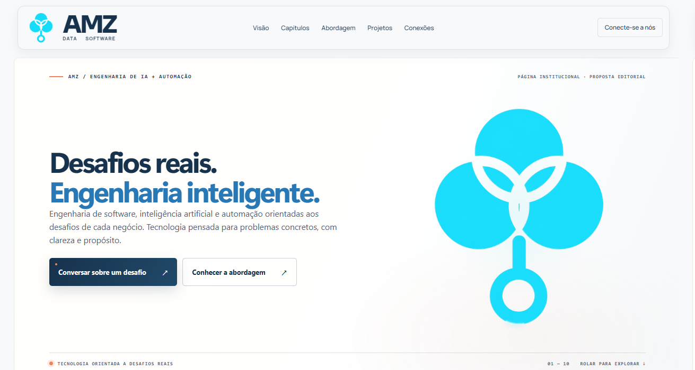

**Print 02 — Hero em mobile estreito de 360 × 800, recorte:**

### 2. Acordeão de capacidades — preservar o conceito; corrigir comportamento

**O que funciona:** os seis painéis compartilham altura, numeração, bordas e linguagem gráfica. O painel aberto é distinguível. No mobile normal, a transformação para uma lista vertical é adequada.

**Composição:** no notebook, o painel expandido ainda divide seu espaço entre texto e ilustração. O texto fica numa coluna estreita, com muitas quebras, enquanto a ilustração mantém uma área relativamente ampla.

**Interação:** foi observada a troca automática; o código define intervalos de sete segundos. A expansão também ocorre imediatamente ao passar o mouse sobre outro painel. A leitura pode ser interrompida quando o usuário apenas atravessa o componente com o ponteiro.

**Falha confirmada:** com movimento reduzido, uma regra posterior reinstala as seis colunas no mobile. O conteúdo fica comprimido e cortado.

**Relações:** conecta-se à paleta dos serviços, mas os dois componentes consecutivos possuem grande presença cromática e exigem exploração prolongada.

**Refinamento concreto:** corrigir primeiro a regra responsiva; depois dar mais largura ao texto no notebook e introduzir intenção na expansão por hover, com pequeno atraso ou ativação por clique.

**Print 03 — Acordeão desktop com painel expandido:**

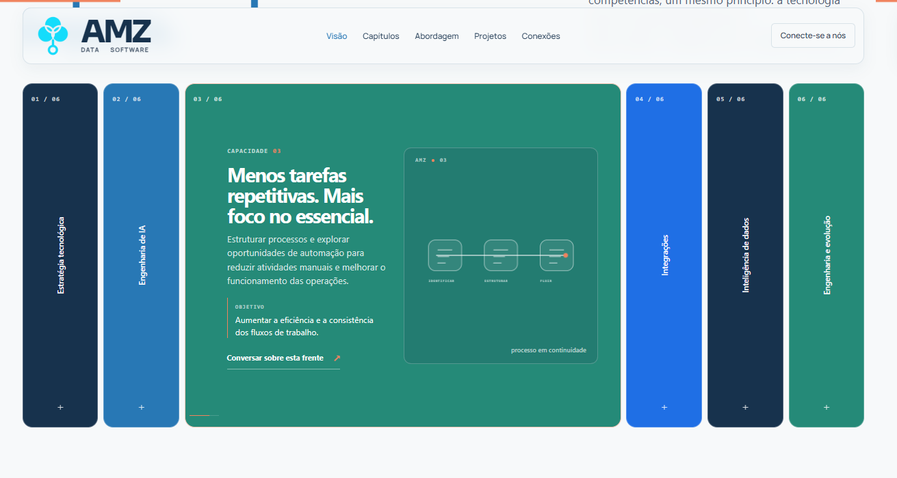

**Print 04 — Notebook de 1280 × 800 durante troca de painel por teclado:**

O foco passou para `capability-trigger-02` e o painel ativo passou para o índice 1. Esta captura registra a transição; a opacidade intermediária não foi classificada como estado de leitura final.

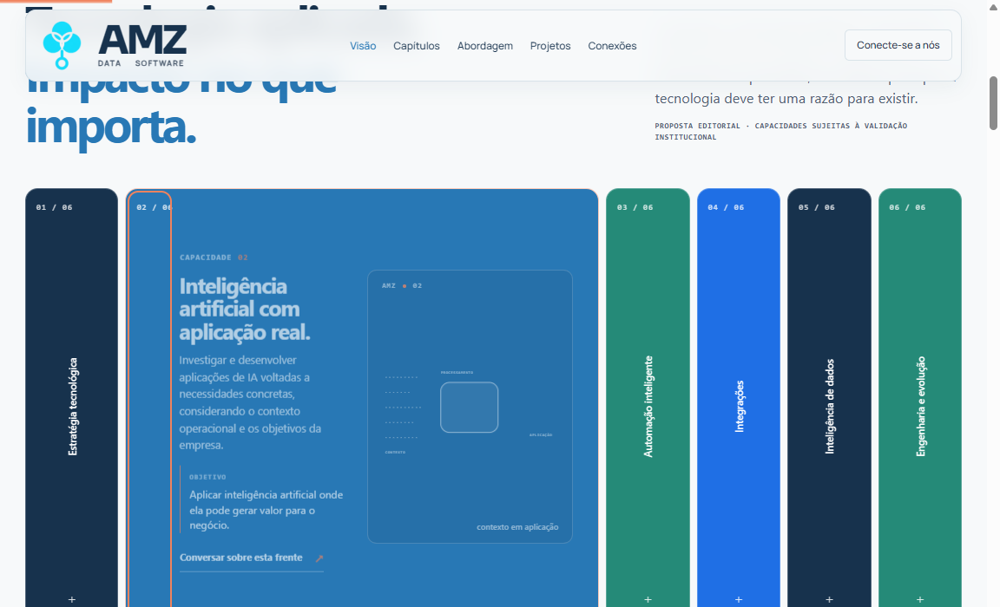

**Print 05 — Mobile de 390 × 844 em modo normal:**

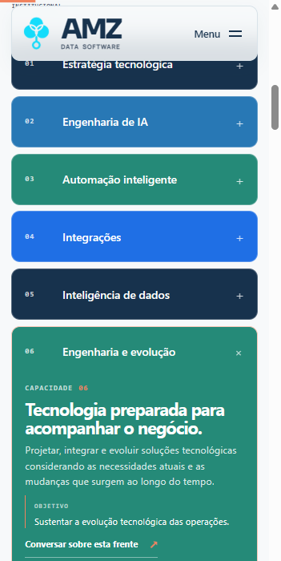

### 3. Serviços empilhados — manter como principal experiência de scroll

**O que funciona:** a acumulação dos painéis é compreensível; as faixas superiores preservam a percepção das camadas; navy → azul → teal → coral claro produz uma evolução visual coerente. O coral atual está mais leve e encerra a sequência sem a intensidade da versão anterior.

**Composição:** os painéis chegam à borda da área de conteúdo, enquanto títulos, abordagem e demais seções seguem margens internas. A diferença é suficientemente grande para parecer uma quebra de grid.

**Ritmo:** em 1440 × 900, a seção mede aproximadamente **3.488 px**, quase quatro alturas de tela. Os quatro marcadores de `70svh`, somados à altura do deck e à abertura, tornam essa a experiência dominante da página.

**Interação:** a pilha respondeu à rolagem. Não foi encontrada evidência de bloqueio do scroll. Isso não confirma desempenho em dispositivos mais lentos.

**Relações:** a saída para o canvas da abordagem funciona cromaticamente. A mudança de largura é mais problemática que a mudança de cor.

**Refinamento concreto:** preservar o empilhamento, estabelecer margens laterais explícitas nos painéis absolutos e experimentar uma redução moderada da duração — inicialmente de 10% a 15%, sem alterar os quatro cards.

**Print 06 — Estado intermediário da pilha desktop:**

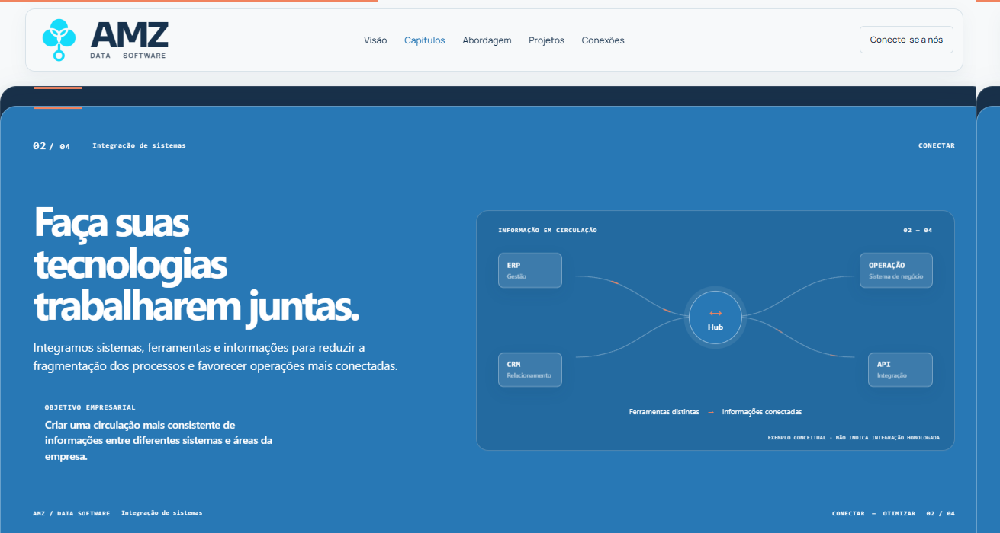

**Print 07 — Serviços no tablet de aproximadamente 768 × 1024, recorte:**

O card continua abaixo do recorte. A ausência do final do painel nesta imagem não foi classificada como corte do componente.

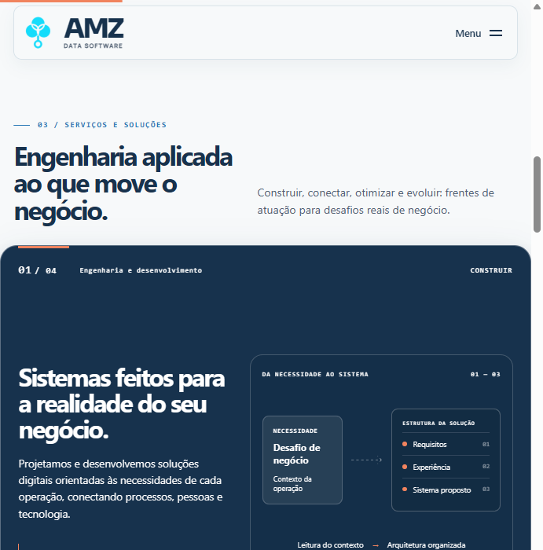

### 4. Abordagem — manter a composição

**O que funciona:** é um dos conjuntos mais resolvidos. Números, ícones, tags, títulos e descrições estão organizados de maneira consistente. Os intervalos horizontais já são suficientes para separar as etapas.

**Composição:** os ícones usam traço, escala e enquadramento semelhantes. A sequência é comunicada por numeração, ordem espacial e progressão cromática, sem necessidade de conectores.

**O que melhorar:** os microtextos de etapa e tags estão pequenos demais para desempenhar uma função de leitura relevante. A quantidade de elementos acima do título cria alguma densidade, mas não justifica redesenhar os cards.

**Relações:** as superfícies claras reduzem a intensidade depois dos serviços. O quarto card navy mantém uma ligação com a composição anterior.

**Refinamento concreto:** preservar os espaçamentos atuais; aumentar ligeiramente os microtextos e reduzir a quantidade de hierarquias concorrentes dentro do topo do card.

**Print 08 — Os quatro cards da abordagem:**

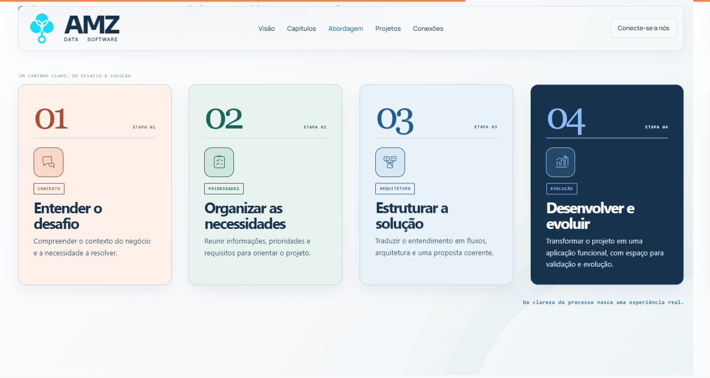

### 5. Interfaces — manter a assimetria; ajustar o mobile

**O que funciona:** a imagem principal tem protagonismo claro, enquanto as duas secundárias acrescentam variedade. Molduras e pequenos controles de janela unificam as três imagens.

**Composição:** no desktop, a assimetria funciona. As imagens secundárias são adequadas como visão geral de interface; não têm tamanho suficiente para leitura dos detalhes internos.

**Motion confirmado:** no desktop, os três reveals estavam completos quando o centro da composição chegou a aproximadamente **429 px numa tela de 900 px**. Ao rolar para cima, os valores recuaram. Esse comportamento está alinhado com a direção solicitada anteriormente.

**Problema mobile:** os prints passam a ocupar uma coluna, mas continuam compartilhando o progresso calculado pelo centro do conjunto inteiro. O primeiro print já estava entre aproximadamente **290 e 581 px** da tela, atravessando o centro, com apenas **27% do reveal**.

**Relações:** a transição da abordagem para imagens é uma boa mudança de linguagem. A saída da seção se alonga com texto de apoio e outro grande bloco de convite antes da faixa.

**Refinamento concreto:** manter o movimento conjunto no desktop e calcular o reveal individualmente por figura no mobile. Não reduzir as imagens para compensar o atraso.

**Print 09 — Composição desktop dos três prints:**

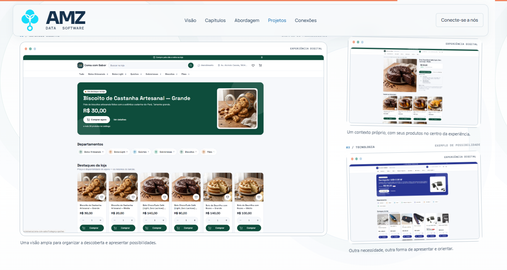

**Print 10 — Reveal atrasado no mobile de 390 × 844:**

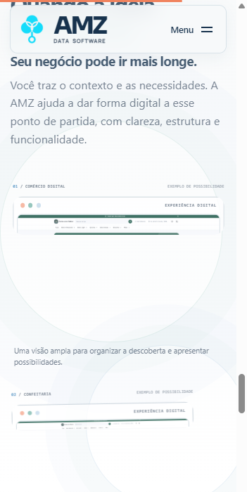

### 6. Tecnologias em conversa — manter como faixa complementar

**O que funciona:** três trilhas, direções alternadas e velocidades distintas criam uma pausa de linguagem. O fade lateral contém o movimento. A seção tem menos peso tipográfico que abordagem e interfaces.

**Composição:** a faixa ocupa aproximadamente **512 px em 1440 × 900**. Já é menor que as seções principais, embora as três fileiras coloridas ainda tenham bastante presença.

**Interação:** o CSS pausa por hover e `focus-within`, mas as cápsulas não são focáveis. Portanto, a segunda condição não oferece, por si só, um caminho de pausa por teclado.

**Relações:** funciona como ponte visual para o contato. A variedade cromática poderia ser menor para que o encerramento ganhasse mais silêncio.

**Refinamento concreto:** manter as três fileiras, diminuir a proporção de cápsulas preenchidas e oferecer um modo de pausa acessível sem transformar as palavras em falsos botões.

**Print 11 — Faixa de tecnologias e começo do contato:**

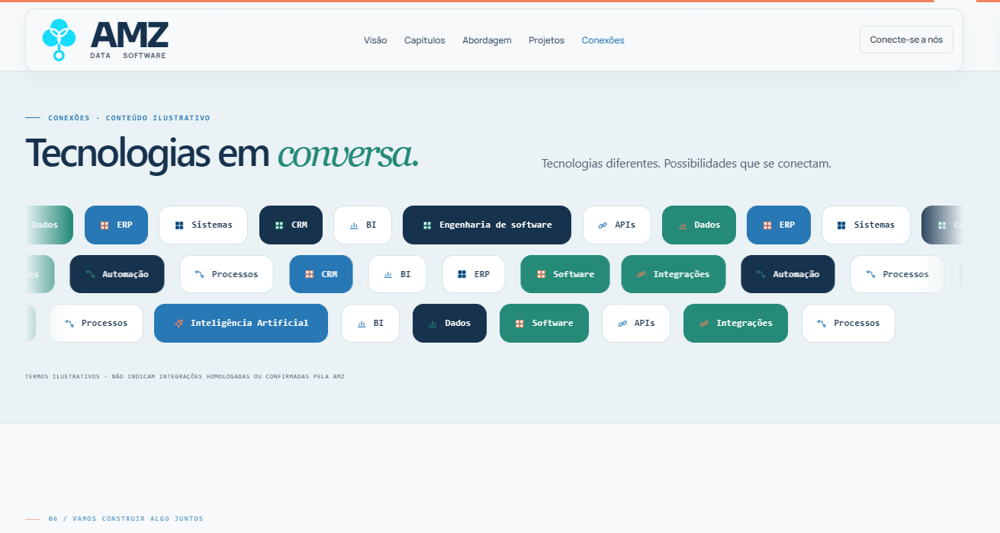

### 7. Contato — manter a estrutura

**O que funciona:** duas colunas, um título de grande escala e uma ação isolada criam um encerramento visual claro. O canvas permite desacelerar depois das três fileiras em movimento.

**Composição:** o título tem mais presença que o link de ação. Essa diferença é acentuada pelo peso tipográfico e pelas três linhas do título no desktop observado.

**Relações:** o principal conflito é com o grande bloco “Próximo passo” da seção de interfaces, que já produz uma primeira sensação de encerramento.

**Refinamento concreto:** reservar o maior peso editorial final para contato e reduzir a presença visual daquele bloco anterior. No contato, dar um pouco mais de área visual à ação, mantendo uma única ação principal.

**Print 12 — Contato desktop:**

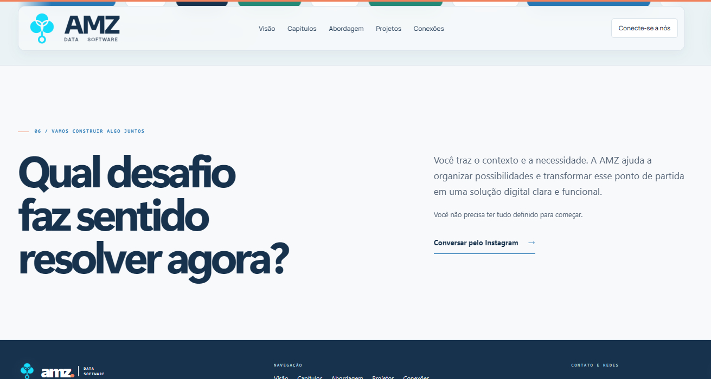

### 8. Footer — manter compacto; harmonizar a marca

**O que funciona:** a superfície navy fecha a página com contraste e contém a navegação sem criar outra seção extensa.

**Inconsistência confirmada:** o cabeçalho usa “AMZ” em maiúsculas, Sora e assinatura abaixo; o footer usa “amz.”, outra fonte e assinatura lateral. São duas construções tipográficas diferentes.

**Refinamento concreto:** manter escala menor e versão inversa no rodapé, mas usar a mesma construção do nome e da assinatura.

**Print 13 — Tecnologias, contato e footer no encerramento:**

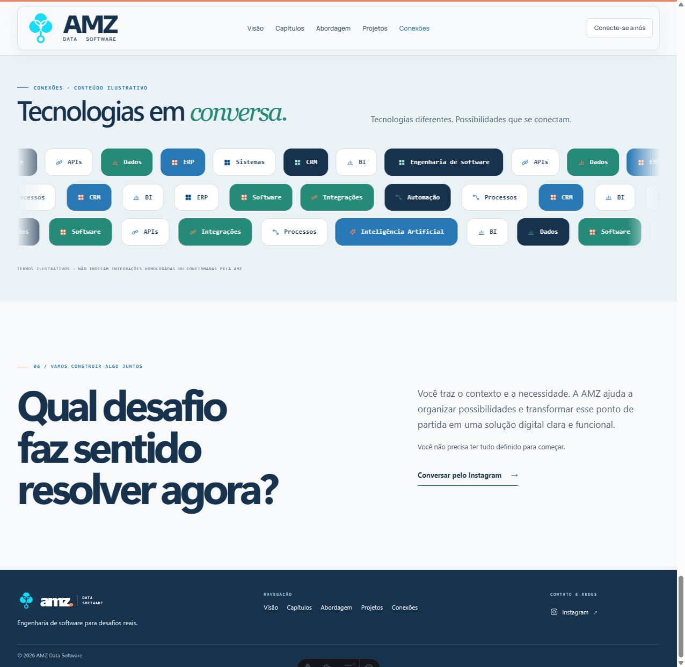

## D. Análise das transições

| Passagem | Avaliação | Ajuste recomendado |
|---|---|---|
| **Hero → Capacidades** | Natural. O canvas permanece e a intensidade passa para os painéis coloridos. | Preservar. Ajustar a altura do Hero mobile antes de mexer no intervalo entre seções. |
| **Capacidades → Serviços** | É a passagem mais carregada: dois grandes componentes interativos e cromáticos consecutivos. | Dar aos serviços uma abertura mais compacta e reduzir sua duração, preservando ambos os padrões. |
| **Serviços → Abordagem** | A passagem do coral claro para o canvas funciona. A largura muda sem continuidade suficiente. | Corrigir margens dos serviços e revisar o espaço após a liberação do sticky. |
| **Abordagem → Interfaces** | Boa alternância entre quatro unidades regulares e uma composição assimétrica. | Preservar. Ajustar o reveal por imagem no mobile; não adicionar elementos de ligação. |
| **Interfaces → Tecnologias** | A faixa é adequada, mas aparece depois de um segundo bloco editorial grande dentro de Interfaces. | Diminuir o peso e a altura desse bloco intermediário. |
| **Tecnologias → Contato** | Natural: termina o movimento e começa uma área de leitura mais calma. | Manter a mudança de densidade; reduzir cápsulas preenchidas antes de reduzir o respiro do contato. |
| **Contato → Footer** | Clara e conclusiva. O navy funciona como fechamento. | Harmonizar a versão da marca; preservar o contraste de superfície. |

Não foi identificada necessidade de plumas, linhas ou partículas para conectar essas passagens.

## E. Problemas encontrados

### Confirmados

| Problema | Evidência e localização | Gravidade | Correção sugerida |
|---|---|---|---|
| **Acordeão mobile quebra com movimento reduzido** | Em 390 × 844, os painéis voltam a seis colunas de aproximadamente 54 px. Regra em `src/components/sections/Overview.astro`, linha 542 na data da auditoria. | **P0** | Remover a redefinição do grid da regra de movimento reduzido; preservar o layout responsivo e apenas desativar movimento. |
| **Reveal atrasado no mobile** | Primeiro print atravessando o centro com progresso de 27%. O cálculo usa o centro de `.showcase-composition` em `src/scripts/pageMotion.ts`, linha 154 na data da auditoria. | **P1** | Usar a geometria de cada figura quando os prints estiverem empilhados. |
| **Contraste insuficiente sobre teal** | Branco sobre `#258A78` resulta em **4,21:1**; textos com opacidade ficam ainda abaixo disso. Aparece em cápsulas e textos pequenos dos painéis. | **P1** | Criar uma variante teal mais escura para superfícies com texto branco ou mudar o tratamento do texto. |
| **Serviços rompem as margens do conjunto** | Painéis medidos com início em `x=0`; os demais blocos seguem margens internas. O deck tem padding, mas os filhos absolutos usam `inset:0`. Ver `src/components/sections/Chapters.astro`, linha 154 na data da auditoria. | **P1** | Aplicar as margens ao posicionamento dos próprios painéis ou ao contêiner interno que os delimita. |
| **Duração concentrada nos serviços** | Aproximadamente 3.488 px no desktop de 900 px de altura; quatro marcadores de `70svh`. | **P1 — ritmo** | Experimentar redução de 10% a 15% e verificar entrada, permanência legível e liberação final. |
| **Duas construções da marca** | Variação explícita entre “AMZ” e “amz.” em `src/components/ui/BrandMark.astro`, linha 10 na data da auditoria. | **P2** | Usar variantes cromáticas e de tamanho da mesma construção. |
| **Pausa do marquee indisponível pelo teclado** | Existe `focus-within`, mas as cápsulas são `span`, sem alvo focável ou controle de pausa. | **P1** | Oferecer pausa acessível ou comportamento estático equivalente. |

Para texto comum, a referência de contraste é **4,5:1**; o limite de **3:1** se aplica a texto grande. Isso torna relevante a correção do teal nas pequenas legendas e cápsulas. Fonte: [W3C — contraste mínimo](https://www.w3.org/WAI/WCAG22/Understanding/contrast-minimum.html).

**Print 14 — Comparação das duas falhas confirmadas no mobile:**

À esquerda, o acordeão em seis colunas com movimento reduzido. À direita, o reveal parcial do primeiro print já atravessando a região central da tela. São dois estados distintos, não uma comparação antes/depois de correção.

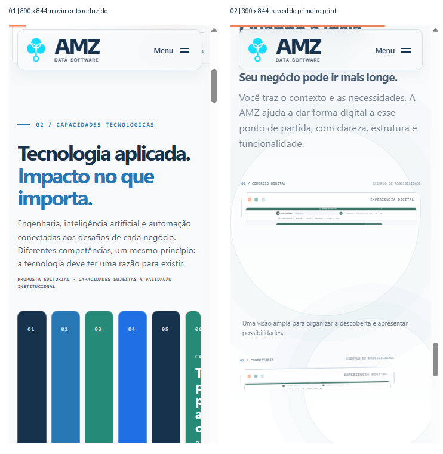

### Riscos e limitações

- **Largura do Hero com barras laterais:** a combinação de `97vw` com padding lateral produziu pequeno excesso de largura na emulação com scrollbar desktop. O `overflow-x:clip` o oculta. Não foi confirmado esse excesso em um celular com barras sobrepostas.
- **Imagens e estabilidade:** os três PNGs exibidos somam aproximadamente **2,9 MB** e não declaram dimensões no HTML. Há risco de carregamento pesado e mudança de geometria; não foram medidos CLS nem rede móvel.
- **Tipografia entre sistemas:** Avenir Next, Segoe UI, Inter, Georgia, Sora e fontes mono participam de diferentes partes da página. Os fallbacks podem alterar quebras e proporções entre Windows e macOS; não foi feita comparação entre sistemas.
- **Suavidade contínua:** as ações de scroll responderam e os estados foram observados, mas não houve gravação de quadros ou medição de FPS. A página não foi classificada como livre de travamentos em todos os dispositivos.

## F. Dez oportunidades de melhoria

| Prioridade | Mudança proposta | Impacto esperado | Esforço |
|---|---|---|---|
| **1. P0** | Corrigir o grid do acordeão em movimento reduzido. | Recuperar conteúdo legível no mobile para quem usa essa preferência. | **Baixo** |
| **2. P1** | Calcular reveal por print no layout em coluna. | Mostrar a primeira imagem enquanto ela é vista, evitando grandes áreas aparentemente vazias. | **Baixo a médio** |
| **3. P1** | Corrigir as combinações de texto pequeno e teal. | Melhorar leitura sem alterar a paleta principal. | **Baixo** |
| **4. P1** | Definir margens laterais explícitas para os serviços empilhados. | Reconectar o componente ao grid da página. | **Baixo a médio** |
| **5. P1** | Reduzir moderadamente a duração dos serviços. | Equilibrar o tempo dedicado aos componentes ao longo da landing. | **Médio**, pela calibração |
| **6. P1** | Retardar o hover do acordeão e ampliar sua coluna de texto no notebook. | Reduzir trocas involuntárias e quebras excessivas. | **Médio** |
| **7. P1** | Tornar a pausa do marquee acessível e reduzir cápsulas preenchidas. | Manter movimento com menor competição visual e controle equivalente. | **Baixo a médio** |
| **8. P2** | Estabelecer dois níveis de microtexto, evitando vários tamanhos abaixo de 10 px. | Melhorar consistência e legibilidade de tags, índices e legendas. | **Médio** |
| **9. P2** | Harmonizar a construção tipográfica da marca no header e footer. | Tornar abertura e encerramento parte da mesma identidade. | **Baixo** |
| **10. P2** | Reduzir o peso do “Próximo passo” em Interfaces e antecipar as ações do Hero. | Melhorar a hierarquia temporal da abertura e do encerramento. | **Baixo a médio** |

## G. Proposta de refinamento estrutural

A sequência deve permanecer:

**Hero → Capacidades → Serviços → Abordagem → Interfaces → Tecnologias → Contato → Footer.**

A evolução recomendada é ajustar o papel visual de cada trecho:

- **Hero:** abertura com símbolo forte, ações que chegam antes e menor custo vertical no mobile.
- **Capacidades:** principal interação de exploração; leitura estável e controle previsível.
- **Serviços:** única experiência longa de empilhamento; margens deliberadas e duração menor.
- **Abordagem:** pausa de leitura organizada, preservando os quatro cards atuais.
- **Interfaces:** principal composição assimétrica; reveal adequado a cada layout.
- **Tecnologias:** faixa secundária em movimento, com mais cápsulas neutras.
- **Contato:** maior gesto editorial do encerramento.
- **Footer:** conclusão compacta com a mesma marca do cabeçalho.

O padrão mais repetido não é o formato de card. É a combinação **microtítulo técnico → título muito grande → amplo intervalo → componente**. Convém reservar a maior escala para Hero e Contato; dar a Capacidades, Serviços e Abordagem aberturas mais claramente diferenciadas em altura e densidade.

### Princípios das referências

Foram consultadas as páginas atuais e observadas suas aberturas no navegador. Na ERA, foi observado também o primeiro trecho de rolagem. Isso sustenta a comparação de hierarquia e composição; não equivale a uma auditoria completa do motion de cada referência.

| Referência | Princípio observado | Aplicação à AMZ |
|---|---|---|
| [Linear](https://linear.app/) | Superfície discreta, hierarquia concentrada e interface como grande área visual. | Diminuir a intensidade das molduras e microdetalhes em torno dos prints. |
| [Stripe](https://stripe.com/br) | Grid visível e alinhamentos estáveis mesmo com uma área cromática expressiva. | Permitir variedade de cor sem perder as margens estruturais. |
| [Vercel](https://vercel.com/) | Poucos elementos dominam a abertura; amplas áreas vazias sustentam uma composição definida. | Avaliar o respiro pela relação entre elementos, evitando espaçamentos grandes aplicados automaticamente a todas as seções. |
| [ERA Residence](https://www.era-residence.com/) | Imagem contínua e mudança de escala tipográfica organizam a primeira passagem de scroll. | Conectar seções por ritmo e proporção, preservando o conteúdo principal durante o movimento. |
| [Toqan](https://toqan.ai/) | Abertura centralizada, controles compactos e baixa densidade de elementos simultâneos. | Reduzir o número de pequenos sinais que disputam atenção nos componentes mais densos. |
| [MindMarket](https://mindmarket.com/) | Grande área de cor, tipografia dominante e ilustração com linguagem consistente. | Reservar intensidade cromática para momentos escolhidos, sem copiar sua paleta ou ilustração. |
| [Thoughtworks](https://www.thoughtworks.com/what-we-do/software-engineering) | Separação clara entre navegação, imagem de abertura e bloco tipográfico. | Preservar funções visuais distintas, sem transformar cada seção em outra abertura. |
| [Globant](https://www.globant.com/studio/engineering) | Uma imagem de grande escala sustenta a seção inicial; os elementos sobrepostos têm quantidade limitada. | Dar a cada seção um protagonista, evitando acumular título, diagrama, brilho e microdetalhes com o mesmo peso. |
| [CI&T](https://ciandt.com/br/pt-br/servicos) | Escala editorial forte, cor de acento seletiva e áreas sem enquadramento de card. | Usar trechos abertos para descansar entre componentes densos. |

A AMZ não precisa adotar fundo preto, gradientes fortes, ilustrações ou cenas 3D dessas referências. O ganho está na disciplina de hierarquia e no controle de intensidade.

### Prints das referências consultadas

As imagens abaixo documentam estados específicos observados em 20/10/2026. Não implicam aprovação de todos os detalhes das referências nem validação de sua experiência completa. Alguns avisos de cookies estavam visíveis na captura de abertura; isso limita a área observada.

#### Linear

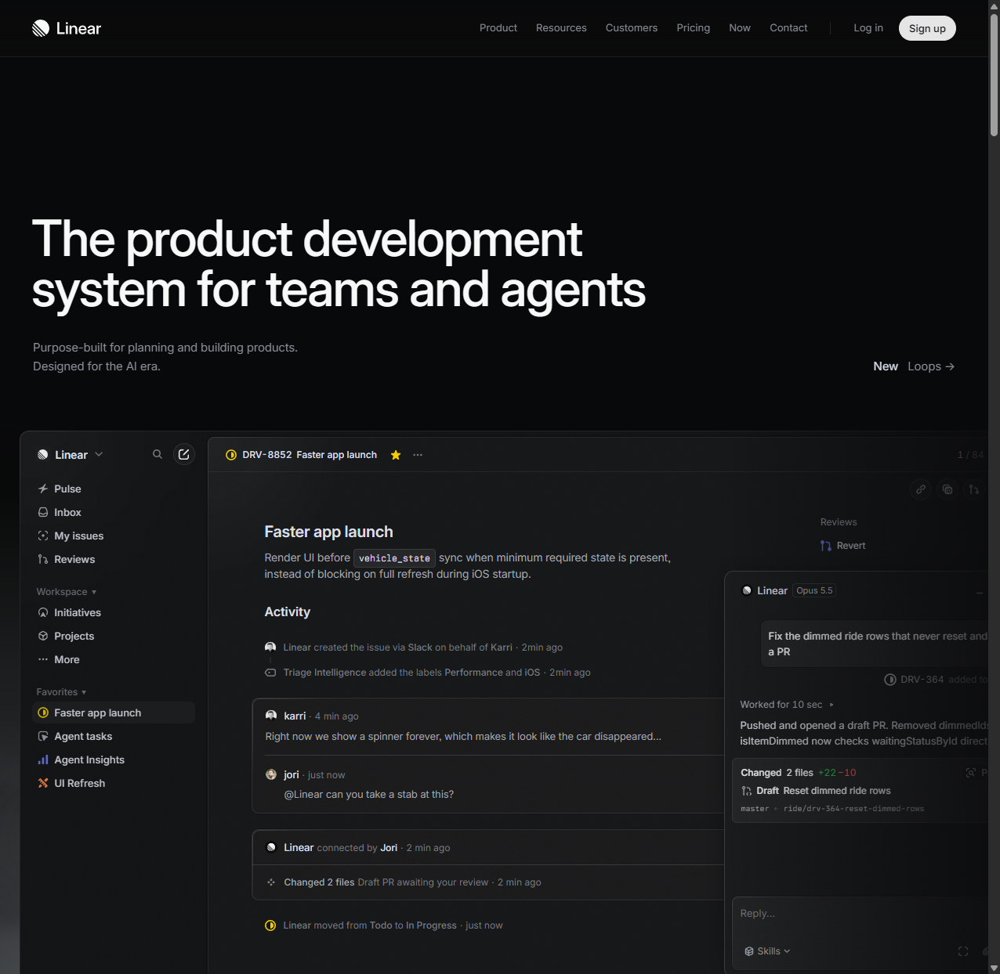

#### Stripe

#### Vercel

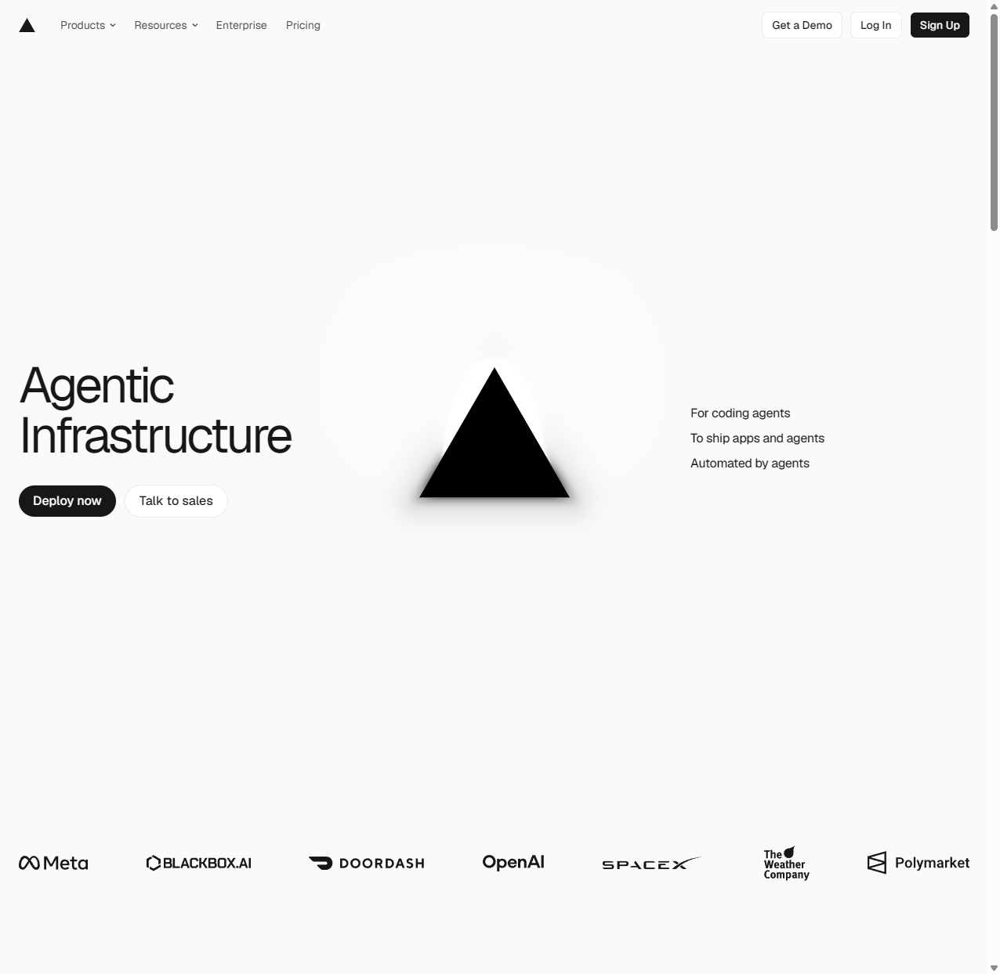

#### ERA Residence — abertura e primeiro trecho de rolagem

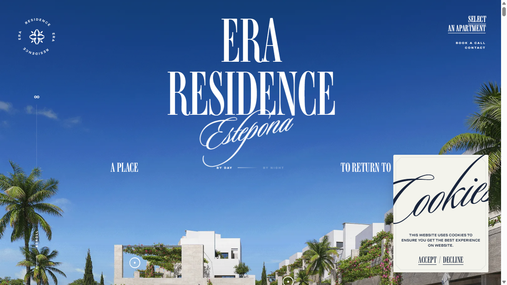

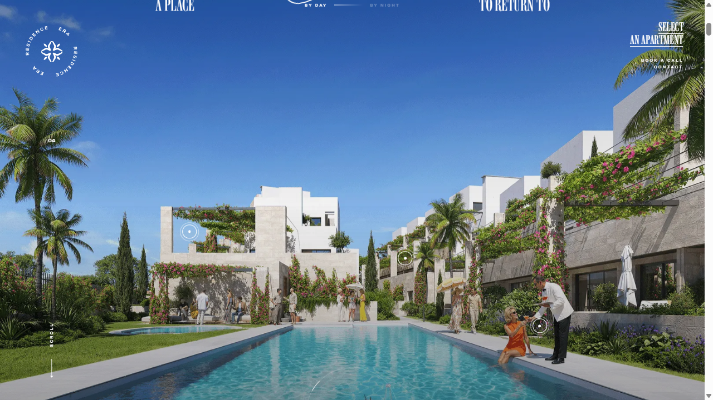

#### Toqan

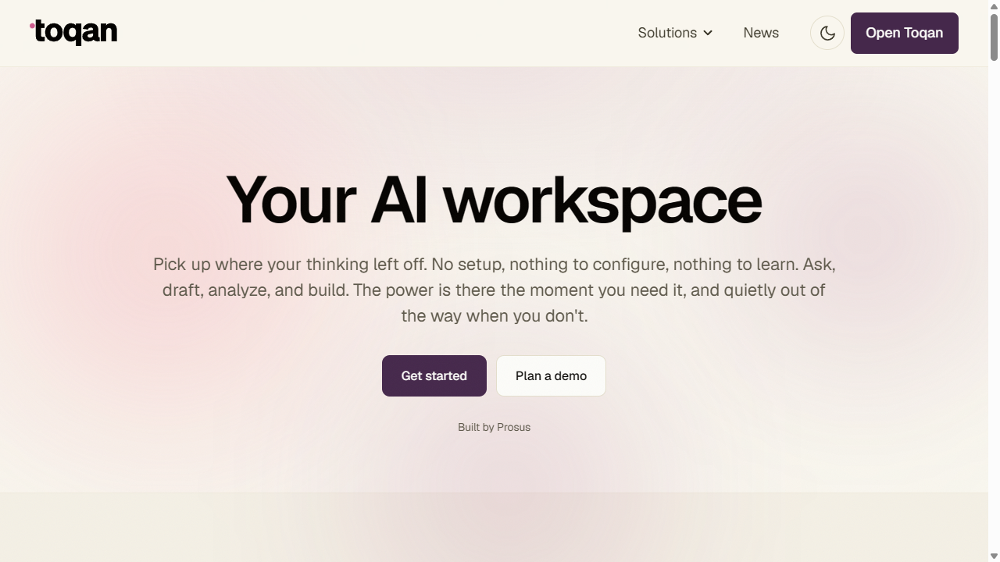

#### MindMarket

#### Thoughtworks

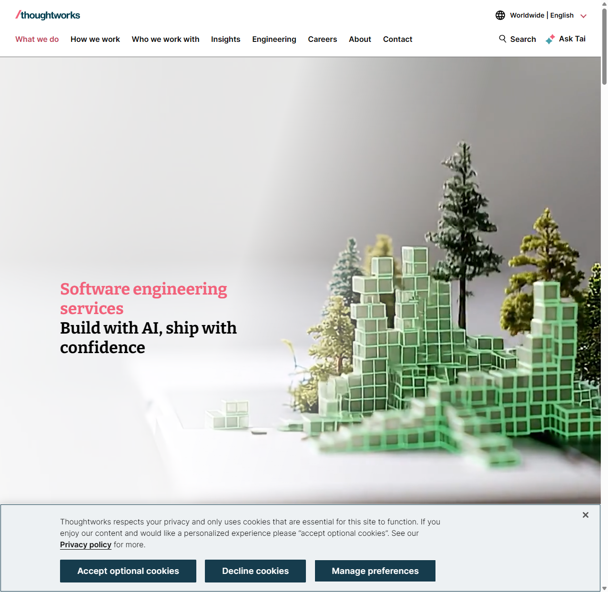

#### Globant

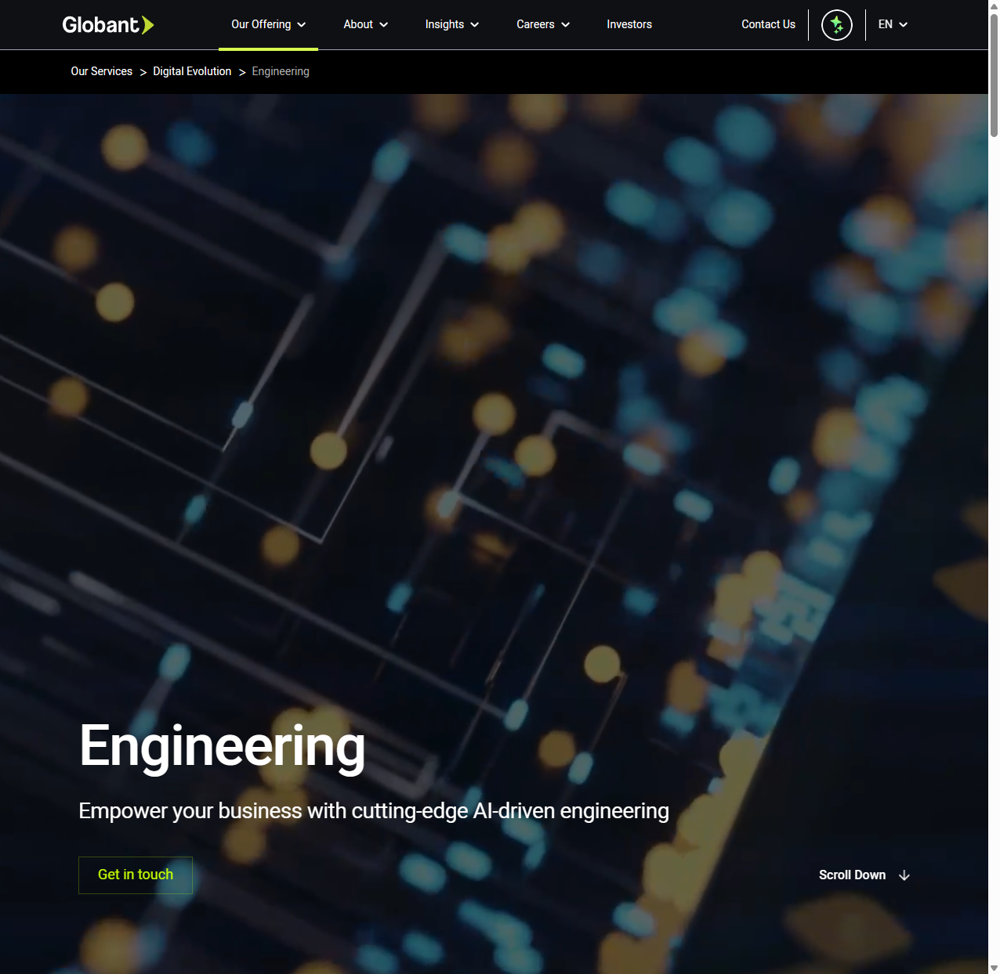

#### CI&T

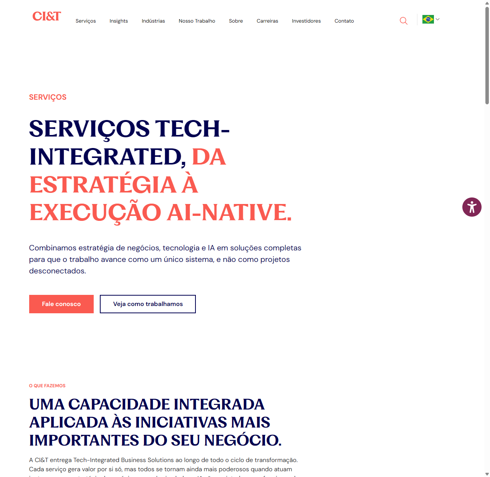

## H. Ordem ideal de implementação

1. **Corrigir o acordeão com movimento reduzido.** Verificar 360, 390 e tablet, mantendo uma coluna.
2. **Ajustar o reveal mobile por figura.** Confirmar que cada imagem esteja completa ao atingir o centro da tela.
3. **Corrigir contraste sobre teal.** Começar pelas cápsulas e textos pequenos.
4. **Resolver as margens dos serviços.** Conferir desktop, notebook e tablet antes de alterar duração.
5. **Calibrar o sticky dos serviços.** Reduzir o percurso em pequena proporção e observar leitura, acumulação e saída nos dois sentidos.
6. **Refinar o acordeão no notebook.** Dar mais largura ao texto e testar hover com intenção, foco e setas.
7. **Regular o encerramento.** Reduzir o protagonismo do bloco anterior à faixa e preservar o contato como destaque final.
8. **Consolidar microtipografia e marca.** Harmonizar índices, tags, legendas e variantes do logotipo.
9. **Refinar o marquee.** Pausa acessível, menos superfícies preenchidas e manutenção do looping.
10. **Fazer a verificação final em aparelhos e rede limitada.** Incluir imagens, estabilidade do layout, foco, scroll rápido e reverso.

As correções de maior retorno são pequenas e localizadas: **layout com movimento reduzido, reveal mobile, contraste e margens dos serviços**. A variedade atual de componentes deve ser preservada.

---

**Estado desta entrega:** diagnóstico documentado com capturas da inspeção. Nenhuma das correções propostas foi aplicada nesta etapa.

**Portabilidade:** as imagens são arquivos locais na pasta ao lado deste Markdown. Ao compartilhar o relatório, envie o arquivo `.md` junto com a pasta `2026-10-20-estrutura-ux-ui-direcao-arte-assets`.
