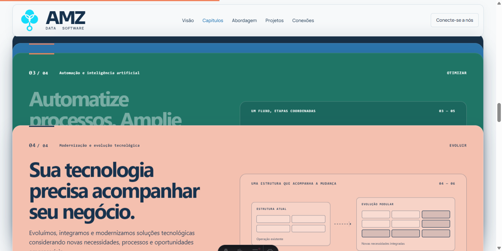
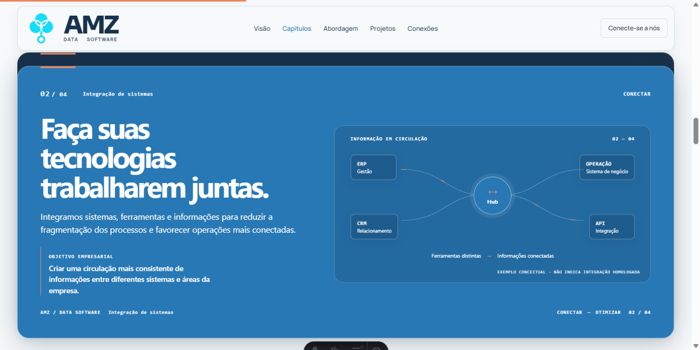
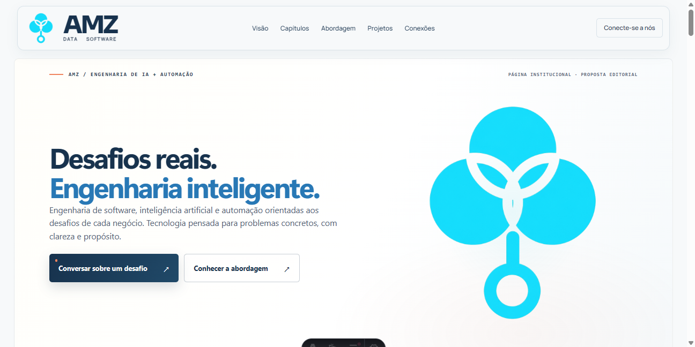
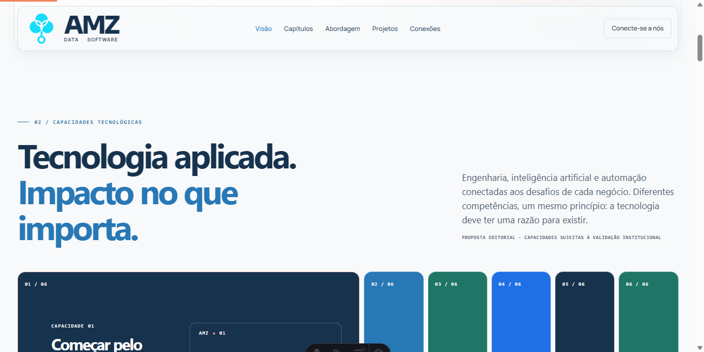
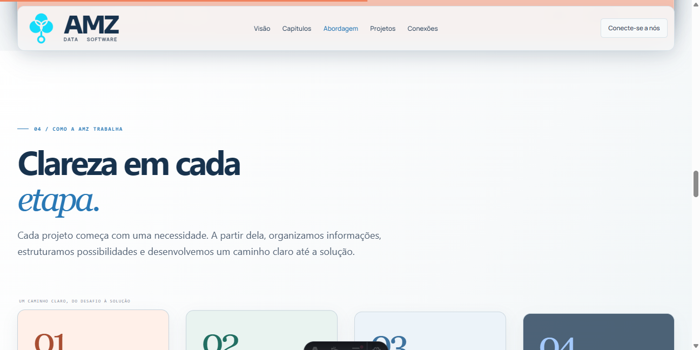
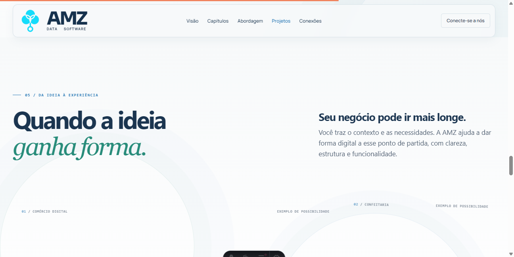
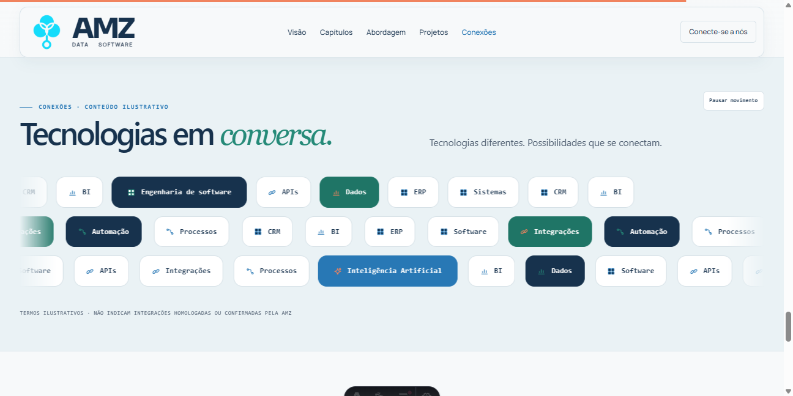

# AMZ Data Software — Etapa 2: refinamento institucional

**Data:** 20/10/2026. **Status:** auditoria editorial e propostas para aprovação; somente correções técnicas localizadas aplicadas.

Projeto: `D:\dev\repositorios\landing-page\amz-landing-starter`, branch `main`, prévia `http://localhost:4321/`.

## A. Diagnóstico da landing institucional

A sequência atual é coerente: apresentação → conhecimento técnico → aplicação prática → organização do trabalho → exemplos → universo tecnológico → conversa → informações institucionais. **Recomendo manter a ordem e os componentes.**

O novo briefing orienta esta análise: a landing apresenta a AMZ como empresa de tecnologia, reconhece soluções próprias e desenvolvimento personalizado e não funciona como catálogo. A proposta anterior de colocar um portfólio de produtos no início não é recomendada para este recorte. Os produtos podem ser mencionados na explicação institucional, sem nomes, preços, apresentações individuais ou novo bloco comercial.

### Achados principais

1. **Identidade pouco explícita:** o Hero apresenta engenharia, IA e automação; não explica de forma direta as duas frentes reconhecidas no briefing. Uma frase de apoio pode resolver isso, sem nova seção “Sobre”.
2. **Redundância de função:** várias capacidades já são descritas como entregas, depois reapresentadas nos cards de serviço. O problema não é repetir uma palavra de marca; é reapresentar a mesma promessa sem acrescentar informação.
3. **A estratégia repete a abordagem:** “compreender a operação” e “definir caminhos” aparecem na primeira capacidade e novamente nos primeiros cards da abordagem.
4. **Exemplos excessivamente homogêneos para representar toda a atuação:** os três prints são experiências de comércio digital. A composição é adequada; a redação deve dizer o que essas imagens permitem visualizar, sem sugerir prova de atuação em diversos tipos de sistemas.
5. **Encerramento reiterativo:** a passagem da abordagem, o apoio das interfaces, o bloco “Próximo passo” e o contato voltam a falar em contexto, necessidade, caminho e solução. Esses espaços podem acrescentar, respectivamente, transição, explicação dos exemplos, convite e instrução de contato.
6. **Navegação editorial:** “Capítulos” descreve a composição; “Projetos” pode sugerir trabalhos comprovados. Alterar esses nomes exige aprovação editorial, mesmo com os destinos funcionando.
7. **Falha técnica confirmada:** os atalhos de serviços do footer apontavam para cards absolutos e transformados pelo sticky. A URL correta não garantia a exibição do card correspondente. Essa inconsistência foi corrigida.

Não há motivo para apresentar a AMZ como especialista em setores, empresa com resultados comprovados ou prestadora de um catálogo irrestrito de serviços sem confirmação. A competência deve ser comunicada pelo que se sabe avaliar e construir, com limites compreensíveis.

## B. Análise seção por seção

### 1. Hero

- **Função:** identificar a empresa e convidar a explorar sua atuação.
- **Diagnóstico:** “Desafios reais. Engenharia inteligente.” é forte e pode permanecer. O subtítulo enumera tecnologias e não explica diretamente a empresa. “AMZ / ENGENHARIA DE IA + AUTOMAÇÃO” pode dar peso excessivo à IA.
- **Sobreposição:** desafios, necessidades e clareza reaparecem no apoio de quase todas as seções.
- **Manter:** composição, marca, título, movimento e duas ações.
- **Propor:** explicar softwares próprios e desenvolvimento personalizado no apoio; avaliar “Conhecer nossa atuação” como ação secundária para serviços. O contato continua a ação comercial principal.
- **Validar:** formulação das duas frentes, peso da IA e destino/rótulo do CTA secundário. Nenhuma redação foi aplicada.

### 2. Capacidades tecnológicas

- **Função:** mostrar conhecimentos e critérios técnicos que sustentam o trabalho.
- **Diagnóstico:** as seis frentes são reconhecíveis, mas descrições como “desenvolver conexões”, “estruturar processos” e “evoluir soluções” já vendem o serviço.
- **Sobreposição:** integração ↔ serviço 02; automação/IA ↔ serviço 03; engenharia/evolução ↔ serviços 01 e 04; estratégia ↔ abordagem 01 e 02.
- **Manter:** accordion, seis frentes, ícones, interação e título principal, se aprovado junto ao novo apoio.
- **Propor:** explicar critérios de decisão e domínio técnico; avaliar substituir o rótulo “OBJETIVO” por “EM FOCO”, com texto específico, sem promessas de eficiência não comprovadas.
- **Validar:** profundidade real de cada competência e quais critérios a equipe aplica efetivamente.

### 3. Serviços — quatro cards empilhados

- **Função:** explicar realizações práticas possíveis a partir das competências.
- **Diagnóstico:** construir, integrar, automatizar e modernizar formam um conjunto compreensível. As descrições e objetivos empresariais às vezes repetem a mesma ideia dentro do próprio card.
- **Sobreposição:** os serviços retomam quase literalmente as capacidades 02, 03, 04 e 06.
- **Manter:** quatro cards, verbos, títulos fortes, diagramas e empilhamento. Não são quatro produtos nem quatro fases obrigatórias.
- **Propor:** descrições centradas no tipo de entrega; objetivos associados à situação operacional atendida. Avaliar o identificador “FRENTES DE ATUAÇÃO” para reduzir a ambiguidade de “SERVIÇOS E SOLUÇÕES”.
- **Validar:** escopo comercial de cada frente e limites de integração, modernização e IA. Não acrescentar manutenção contínua, suporte contratado ou garantias.

### 4. Abordagem

- **Função:** explicar como a AMZ organiza a conversa e o trabalho.
- **Diagnóstico:** título e quatro cards funcionam. O apoio descreve novamente a promessa geral. A capacidade “Estratégia tecnológica” já antecipa parte desse conteúdo.
- **Sobreposição:** contexto, prioridades e caminho repetem estratégia; “desenvolver e evoluir” repete a oferta dos serviços.
- **Manter:** título, composição, número de cards e caráter editorial.
- **Propor:** explicitar decisões de trabalho: entender, priorizar, organizar escopo e revisar a implementação. Na transição para interfaces, dizer que serão vistos exemplos.
- **Validar:** se essa organização corresponde à prática dos três integrantes. Não nomear “metodologia AMZ”, nem prometer sequência obrigatória ou prazos.

### 5. Aplicações e experiências

- **Função:** permitir visualizar escolhas de interface e usos de tecnologia.
- **Diagnóstico:** título e composição assimétrica são adequados. “Seu negócio pode ir mais longe” e o apoio não descrevem o que está nas imagens. O rótulo “TECNOLOGIA” identifica uma loja de celulares de forma muito ampla.
- **Sobreposição:** apoio inicial, “O contexto é seu...” e “O próximo desafio pode ser o seu” voltam ao convite comercial antes do contato.
- **Manter:** título, prints, composição e identificação ilustrativa. Não converter em catálogo.
- **Propor:** explicar navegação, organização de informações e experiência de uso; avaliar “LOJA DE CELULARES” no terceiro exemplo. Usar o apoio para transparência, sem tratar as imagens como cases.
- **Validar:** origem, autorização, autoria e classificação de cada imagem. O LEIA-ME identifica comércio-eletrônico como captura pública da Coma com Sabor; não prova trabalho da AMZ. As outras duas imagens em uso precisam de comprovação própria. FinControl e Gestão de Enxoval, não utilizados nesta composição, têm alerta de tratamento por IA e não são prints autênticos comprovados.

### 6. Tecnologias em conversa

- **Função:** faixa de apoio que retoma o universo técnico e conduz ao encerramento.
- **Diagnóstico:** título, apoio e aviso ilustrativo já cumprem essa função.
- **Sobreposição:** termos repetem o vocabulário técnico de outras seções, mas aqui têm função visual sintética.
- **Manter:** redação, três trilhas, pausa e aviso de ausência de homologação. Nenhum novo CTA.
- **Propor:** nenhuma reformulação necessária nesta etapa.
- **Validar:** somente futuras inclusões de termos, marcas ou afirmações de compatibilidade.

### 7. Contato

- **Função:** dizer ao visitante como começar a conversa.
- **Diagnóstico:** título, acolhimento e WhatsApp confirmado funcionam. O parágrafo recapitula a descrição da abordagem e das aplicações.
- **Sobreposição:** “contexto”, “necessidade”, “organizar possibilidades”, “ponto de partida” e “solução clara” já apareceram antes.
- **Manter:** composição, título, frase de acolhimento e “Conversar com a AMZ”.
- **Propor:** trocar somente o apoio por uma instrução concreta sobre o que contar ao iniciar o contato.
- **Validar:** expectativa real de atendimento e conteúdo do primeiro contato. Não inserir prazo de resposta, orçamento gratuito ou diagnóstico garantido.

### 8. Footer

- **Função:** oferecer navegação complementar, oportunidades e informações institucionais.
- **Diagnóstico:** quatro grupos, canais confirmados e documentos têm funções distintas. A repetição resumida de links é útil para navegação e não exige exclusão.
- **Manter:** estrutura, identidade, textos e destinos de talentos/parcerias. Privacidade e cookies seguem preliminares.
- **Propor:** nenhum redesign ou nova frente de conteúdo. O nome público de “Projetos e experiências” poderá acompanhar a futura decisão sobre o rótulo das aplicações.
- **Validar:** canais especializados e documentos definitivos, conforme pendências existentes. Sem programas de parceria, vagas ou páginas artificiais.

## C. Capacidades, serviços e abordagem: divisão objetiva

| Tema | Onde a redação atual se sobrepõe | Capacidades: conhecimento | Serviços: realização | Abordagem: organização |
|---|---|---|---|---|
| Estratégia | Capacidade 01 “Compreender a operação...” ↔ abordagem 01/02 | Critérios para avaliar processos, restrições e prioridades | Explicar a aplicação pretendida dentro do serviço pertinente | Conversar, reunir informações e acordar prioridades |
| IA | Capacidade 02 “Investigar e desenvolver aplicações...” ↔ serviço 03 “Aplicamos automação e IA...” | Avaliar adequação, informações disponíveis e limites da IA | Implementar uma aplicação ou fluxo definido, quando pertinente | Validar uso e revisar implementação sem impor IA |
| Automação | Capacidade 03 “Estruturar processos...” ↔ serviço 03 “estruturando fluxos...” | Conhecer regras, dependências e pontos de controle | Construir um fluxo automatizado | Definir escopo e prioridades; acompanhar revisões |
| Integrações | Capacidade 04 “Desenvolver conexões...” ↔ serviço 02 “Integramos sistemas...” | Compreender formatos e regras de troca de dados | Conectar sistemas para uma finalidade delimitada | Levantar dependências e combinar o trabalho |
| Dados | Capacidade 05 “Organizar e explorar dados...” ↔ linguagem de informação nos serviços | Estruturar e interpretar informações | Exemplo contextual dentro de uma entrega confirmada; não criar quinto serviço | Identificar quais informações são relevantes ao projeto |
| Engenharia/evolução | Capacidade 06 “Projetar, integrar e evoluir...” ↔ serviços 01/04 e abordagem 04 | Estrutura do software e critérios de manutenção/mudança | Construir ou atualizar uma aplicação | Planejar implementação e revisão; não prometer suporte permanente |

**Perguntas que devem guiar a leitura:** “O que dominamos?” → “O que podemos realizar?” → “Como organizamos o trabalho?”. As duas frentes institucionais podem ser explicadas no Hero sem mudar essa sequência.

## D. Sugestões de redação — não aplicadas

As propostas são rascunhos editoriais. Termos técnicos abaixo descrevem uma possível comunicação das competências existentes; sua correspondência com as práticas reais exige validação.

### Abertura e títulos

| Texto atual | Nova proposta | Justificativa |
|---|---|---|
| “Desafios reais. Engenharia inteligente.” | **Manter.** | Preserva personalidade e continuidade; o apoio deve esclarecer a empresa. |
| “AMZ / ENGENHARIA DE IA + AUTOMAÇÃO” | “AMZ / SOFTWARE E TECNOLOGIA APLICADA” | Amplia a identificação sem acrescentar um setor ou uma certificação. |
| “Engenharia de software, inteligência artificial e automação orientadas aos desafios de cada negócio. Tecnologia pensada para problemas concretos, com clareza e propósito.” | “A AMZ desenvolve softwares próprios e aplicações personalizadas. Combinamos engenharia de software, integração e automação para apoiar operações e iniciativas digitais.” | Explica a empresa e as duas frentes sem catálogo ou promessas de resultado. |
| “Conhecer a abordagem” → `#abordagem` | “Conhecer nossa atuação” → `#capitulos` | Leva o visitante à aplicação prática antes do processo. É uma mudança editorial de rótulo e destino; requer aprovação. |
| “Tecnologia aplicada. Impacto no que importa.” | **Manter**, com apoio mais específico abaixo. | Uma mudança no apoio pode resolver a função da seção sem reescrever o título. |
| Apoio das capacidades: “Engenharia, inteligência artificial e automação conectadas aos desafios de cada negócio...” | “As competências que orientam nossas decisões: analisar processos, organizar informações e definir como o software deve funcionar.” | Introduz conhecimento e avaliação, em vez de repetir serviços. |
| “SERVIÇOS E SOLUÇÕES” | “FRENTES DE ATUAÇÃO” | Identifica aplicações da competência, sem sugerir catálogo ou sequência obrigatória. |
| “Engenharia aplicada ao que move o negócio.” | **Manter.** Apoio proposto: “Desenvolver aplicações, conectar sistemas, automatizar rotinas e atualizar tecnologias existentes.” | A lista esclarece o que a seção apresenta. |

### As seis capacidades

Manter os seis rótulos inicialmente. Revisar descrição e apoio “OBJETIVO” em conjunto para não repetir uma promessa dentro do mesmo painel.

| Capacidade / trecho atual | Descrição proposta | Diferença pretendida |
|---|---|---|
| Estratégia: “Compreender a operação, identificar oportunidades e definir caminhos...” | “Análise de processos, restrições e prioridades para orientar decisões tecnológicas.” | Critérios de análise; o contato e o levantamento pertencem à abordagem. |
| IA: “Investigar e desenvolver aplicações de IA voltadas a necessidades concretas...” | “Avaliação da adequação da IA à tarefa, às informações disponíveis e aos limites de uso.” | Conhecimento de aplicação; a entrega aparece nos serviços. |
| Automação: “Estruturar processos e explorar oportunidades de automação...” | “Leitura de regras, dependências e pontos de controle de um processo.” | Fundamentação técnica, sem promessa automática de eficiência. |
| Integrações: “Desenvolver conexões entre ferramentas, processos e informações...” | “Compreensão dos formatos de dados e das regras de troca entre sistemas.” | Conhecimento que permite conectar; não repete o serviço. |
| Dados: “Organizar e explorar dados relevantes...” | “Organização e interpretação de informações para compreender as operações.” | Mantém a competência existente sem inventar produto de BI. |
| Engenharia/evolução: “Projetar, integrar e evoluir soluções tecnológicas...” | “Estrutura do software e critérios para facilitar manutenção e mudanças.” | Explica o domínio técnico; construir e modernizar ficam nos serviços. |

Os headlines internos podem ser preservados quando compatíveis com essa divisão. Avaliar “Automação com regras e controle” no lugar de “Menos tarefas repetitivas. Mais foco no essencial.” para que o painel não antecipe a promessa do serviço 03. O eventual rótulo “EM FOCO” deve apontar critérios específicos; não apenas trocar a palavra “OBJETIVO”.

### Serviços

Preservar os quatro títulos atuais. Alterar apenas as descrições que reiteram os painéis de capacidades:

| Card / trecho atual | Descrição proposta | Justificativa |
|---|---|---|
| 01: “Projetamos e desenvolvemos soluções digitais orientadas às necessidades de cada operação...” | “Desenvolvimento de sistemas e aplicações para organizar rotinas, registros e fluxos de trabalho.” | Torna a entrega reconhecível. |
| 02: “Integramos sistemas, ferramentas e informações para reduzir a fragmentação...” | “Conexão entre sistemas para trocar informações e apoiar atividades que atravessam mais de uma ferramenta.” | Explica uma aplicação prática sem anunciar compatibilidade específica. |
| 03: “Aplicamos automação e inteligência artificial a desafios concretos, estruturando fluxos...” | “Implementação de fluxos para executar tarefas definidas e tratar exceções, com IA quando adequada à aplicação.” | Delimita a realização e condiciona o uso de IA. Confirmar o escopo antes de publicar. |
| 04: “Evoluímos, integramos e modernizamos soluções tecnológicas considerando novas necessidades...” | “Atualização de aplicações existentes e de seus componentes, de acordo com as mudanças requeridas pela operação.” | Separa modernização de construção de uma aplicação nova. |

Os objetivos empresariais precisam acompanhar entregas confirmadas. Evitar repetir a descrição com “transformar”, “melhorar” ou “apoiar” sem informação adicional.

### Abordagem, aplicações e contato

| Texto atual | Nova proposta | Justificativa |
|---|---|---|
| “Clareza em cada etapa.” | **Manter.** | Título adequado para organização do trabalho. |
| “Cada projeto começa com uma necessidade. A partir dela, organizamos informações...” | “A conversa inicial ajuda a definir o que precisa ser feito, as prioridades e o caminho de desenvolvimento.” | Explica o trabalho e reduz a repetição da promessa institucional. |
| Abordagem 03: “Traduzir o entendimento em fluxos, arquitetura e uma proposta coerente.” | “Organizar escopo, fluxos e responsabilidades técnicas antes da implementação.” | Traz conteúdo mais operacional. Depende da confirmação da prática. |
| Abordagem 04: “Transformar o projeto em uma aplicação funcional, com espaço para validação e evolução.” | “Implementar, revisar e planejar ajustes conforme o uso.” | Comunica organização sem prometer manutenção contínua. |
| “Da clareza do processo nasce uma experiência real.” | “Veja possibilidades de aplicação.” | Evita que uma galeria ilustrativa pareça prova de entregas reais. |
| “Quando a ideia ganha forma.” | **Manter.** | Serve à visualização de possibilidades sem precisar nomear produtos. |
| “Seu negócio pode ir mais longe.” | “Interfaces, fluxos e formas de uso.” | Descreve o conteúdo apresentado. |
| “Você traz o contexto e as necessidades. A AMZ ajuda a dar forma digital...” | “Exemplos de interfaces para organizar informações, apresentar produtos e orientar a navegação.” | Descreve o que os prints de comércio permitem observar. “Produtos” aqui se refere aos itens das lojas ilustradas, não ao catálogo AMZ. |
| Exemplo 03: “TECNOLOGIA” | “LOJA DE CELULARES” | Corresponde ao conteúdo da imagem e do alt existente. Não é nova especialização AMZ. |
| “O CONTEXTO É SEU. O CAMINHO, CONSTRUÍDO EM CONJUNTO.” e o parágrafo seguinte | “SOBRE OS EXEMPLOS” / “As imagens ilustram escolhas de interface. Escopo e funcionalidades dependem de cada aplicação.” | Acrescenta transparência, sem repetir a abordagem. |
| “O próximo desafio pode ser o seu.” | **Manter o convite como alternativa**, revendo a necessidade do parágrafo seguinte na aprovação editorial. | O bloco já tem hierarquia visual própria; não remover componente automaticamente. O contato deve conter a instrução completa. |
| “Tecnologias em conversa.” e “Tecnologias diferentes. Possibilidades que se conectam.” | **Manter**, junto do aviso ilustrativo. | Função de faixa de apoio já está definida. |
| “Qual desafio faz sentido resolver agora?” | **Manter.** | Convite direto; a repetição pontual de “desafio” com o Hero cria continuidade. |
| “Você traz o contexto e a necessidade. A AMZ ajuda a organizar possibilidades...” | “Conte o que você pretende desenvolver, conectar ou melhorar. Esse é o ponto de partida para conversar com a AMZ.” | Dá uma instrução prática sem garantir atendimento específico ou resultado. |
| “Você não precisa ter tudo definido para começar.” / “Conversar com a AMZ” | **Manter.** | Acolhimento e ação já são claros. |

**Navegação — proposta para aprovação:** “Visão” → “Competências”; “Capítulos” → “Atuação”; “Projetos” → “Experiências”. Preservar os IDs e sua compatibilidade. Não mudar o footer ou a navegação automaticamente nesta rodada.

## E. Comparação com as referências

As referências foram consultadas como fontes primárias de organização e comunicação. Não foram copiados textos, ativos, layouts ou efeitos. Não se inferiu que a AMZ tem o porte, os clientes, os métodos ou as capacidades dessas empresas.

| Referência | Observação útil | Aplicação à AMZ | Limite |
|---|---|---|---|
| [Linear](https://linear.app/) | A abertura identifica o propósito e a interface dá suporte à explicação | Título com personalidade acompanhado de um apoio que explica a empresa | Não transformar a home institucional em demonstração de um único produto |
| [Stripe](https://stripe.com/br) | Distingue produtos, soluções e caminhos de contato | Dar nomes e funções diferentes a competência, atuação e abordagem | Não importar catálogo ou promessa de receita |
| [Vercel](https://vercel.com/) | Agrupa plataforma, ferramentas e aplicações com nomes específicos | Rótulos concretos, inclusive nas imagens; hierarquia sem proliferar seções | Não assumir que infraestrutura ou ferramentas semelhantes integrem a oferta AMZ |
| [Thoughtworks](https://www.thoughtworks.com/) | Distingue o que faz, como trabalha e trabalhos de clientes | Separar oferta, organização e evidência | Não importar plataforma própria, governança ou promessa de custo |
| [Globant](https://www.globant.com/) | Oferta, conteúdo institucional e histórias têm entradas próprias | Competências precisam de explicação e contexto de aplicação | Não replicar linguagem de escala global, parcerias ou autoridade por associação |
| [CI&T](https://ciandt.com/br/pt-br/) | Apresenta frentes específicas e separa “Nosso trabalho” de “Como trabalhamos” | Diferenciar capacidades, serviços, abordagem e natureza dos exemplos | Não chamar o percurso AMZ de método formal inspirado no deles |
| [FCamara](https://fcamara.com/en/) | Separa jornadas, centros de excelência e setores | Evitar misturar conhecimento, aplicação e mercado atendido na mesma lista | Não criar setores ou centros de especialização para a AMZ |
| [Toqan](https://toqan.ai/) | Explica ações possíveis com verbos e interface de apoio | Descrever realizações compreensíveis em vez de acumular abstrações | Não atribuir workspace ou funcionalidades de IA semelhantes à AMZ |
| [MindMarket](https://mindmarket.com/) | Distingue serviços, metodologia e setores na organização do conteúdo | Atribuir uma pergunta própria a cada bloco | É referência de comunicação/editorial, não de modelo de software |
| [ERA Residence](https://www.era-residence.com/) | Estrutura uma apresentação editorial apoiada em imagens e títulos | Preservar o ritmo e deixar o conteúdo orientar a passagem entre blocos | Não trazer linguagem imobiliária, imagens ou novo efeito de scroll |

A comparação de motion nesta etapa é de direção editorial, não medição de durações, FPS ou implementação interna das referências. Os timings e efeitos da AMZ foram preservados; a única intervenção no script trata destinos de navegação.

## F. Estrutura institucional recomendada

**Manter:** Hero → Capacidades → Serviços → Abordagem → Aplicações → Conexões → Contato → Footer.

1. **Hero:** quem é a AMZ e quais são suas duas frentes, em poucas linhas.
2. **Capacidades:** conhecimentos e critérios que sustentam o trabalho.
3. **Serviços:** o que esse conhecimento permite realizar.
4. **Abordagem:** como a conversa e o trabalho são organizados.
5. **Aplicações:** exemplos para visualizar interfaces e uso; classificação visível e verdadeira.
6. **Conexões:** síntese visual do universo técnico.
7. **Contato:** o que contar para iniciar uma conversa e qual canal usar.
8. **Footer:** navegação, oportunidades e transparência institucional.

Não adicionar seção de produtos, seis apresentações individuais, novas promessas ou um bloco “Sobre” redundante. A menção institucional às soluções próprias pode ficar no Hero; aprofundamentos comerciais pertencem às páginas próprias.

## G. Pendências de validação dos três integrantes

1. Qual redação comum descreve a AMZ e suas duas frentes? A prioridade comercial mencionada por duas visões no briefing não determina automaticamente o peso de cada frente nesta landing.
2. Quais das seis competências são efetivamente oferecidas e com que profundidade? Há serviços que exigem análise prévia, parceiro ou limitação de escopo?
3. O que cada frente entrega? Confirmar limites entre desenvolvimento, integração, automação e modernização; não presumir contratos de suporte.
4. Os quatro cards da abordagem representam a prática compartilhada? Que decisões são realmente tomadas antes e durante a implementação?
5. Qual é a origem de cada uma das três imagens em uso? Há autorização e comprovação de autoria, ou devem permanecer como referência ilustrativa?
6. Quais exemplos representam melhor a atuação sem induzir especialização exclusiva em comércio digital? A resposta não autoriza substituir imagens nesta etapa.
7. Como funciona o primeiro atendimento e quais expectativas podem ser comunicadas sem promessa de prazo ou entrega gratuita?
8. Quem aprova textos, descrições técnicas e classificação de evidências antes da publicação? Quem mantém as informações atualizadas?

Não foram encontrados documentos individuais adicionais dos integrantes no projeto. O briefing atual informa a convergência parcial de duas visões; as propostas deste relatório não foram tratadas como consenso dos três.

Persistem as pendências de privacidade e cookies já registradas, sem novo parecer jurídico ou mudança de status nesta rodada.

## H. Plano de implementação e alterações realizadas

### Priorização

| Prioridade | Recomendação | Impacto | Esforço | Condição |
|---|---|---|---|---|
| P0 | Corrigir atalhos para os cards sticky | Alto para navegação funcional | Baixo a médio | **Implementado**; não depende de posicionamento |
| P0 | Retirar orientação fixa da descrição acessível do accordion | Acessibilidade | Baixo | **Implementado**; desktop horizontal/mobile vertical |
| P0 | Separar legenda e aviso ilustrativo no diagrama de integração | Legibilidade | Baixo | **Implementado**; reserva localizada de espaço, sem redesenhar diagrama |
| P0 | Atualizar pendências documentais que descreviam uma versão antiga | Governança | Baixo | **Implementado**; canais, Hero e quantidade de imagens conferidos no código |
| P1 | Aprovar a divisão competência → realização → organização | Alto para clareza | Baixo técnico | Aprovação editorial e institucional |
| P1 | Aprovar apoio do Hero e identificação das duas frentes | Alto | Baixo | Três integrantes; nenhuma mudança automática |
| P1 | Confirmar capacidades, escopos e origem dos prints | Alto para responsabilidade institucional | Trabalho de validação | Informação institucional |
| P2 | Aplicar descrições de capacidades e serviços em conjunto | Alto para reduzir repetição | Médio | Escopos e redação aprovados |
| P2 | Refinar apoio da abordagem e textos das aplicações | Médio | Baixo | Organização do trabalho e evidências validadas |
| P2 | Simplificar apoio do contato e rever parágrafo do “Próximo passo” | Médio | Baixo | Aprovação editorial |
| P2 | Ajustar rótulos de navegação, se aprovados | Médio | Baixo | Decisão editorial; manter IDs |

### Correção técnica dos atalhos

Antes: clicar “Integrações” podia resultar em `#integracao` com o card 04 ativo. As âncoras existiam, mas pertenciam a elementos transformados pelo empilhamento.

Depois: o script calcula a posição de término de entrada do card solicitado usando os mesmos parâmetros já utilizados pela timeline. As fórmulas foram extraídas para uma função compartilhada, sem alterar seus valores. O tratamento contempla clique normal, fragmento inicial e retorno pelo histórico. No mobile e com movimento reduzido, a navegação nativa permanece em uso. Não foram alterados tempos de animação, markers, paleta ou estrutura dos cards.

Os atalhos mantêm o hash, permitem foco no conteúdo correspondente e removem o tabindex temporário ao sair do destino. Cliques modificados e links de outra origem não são interceptados.

### Arquivos desta etapa

- `src/scripts/pageMotion.ts`: resolução dos fragmentos de cards sticky e compartilhamento da fórmula existente de entrada.
- `src/components/sections/Overview.astro`: `aria-roledescription="acordeão"`, sem orientação fixa.
- `src/components/sections/Chapters.astro`: uma regra de padding inferior no diagrama de integração, para separar legenda e aviso ilustrativo.
- `docs/CONTENT_PENDING.md`: sincronização factual com o Hero, canais e três imagens atuais; propostas seguem pendentes.
- Este relatório e suas evidências.

Nenhum título, descrição institucional, CTA, ícone, print, footer, página legal ou token visual foi reformulado. As alterações locais anteriores foram preservadas. Não houve commit, push ou deploy.

### Evidências e validações

Resultados verificados nesta rodada:

- `npm run check`: 24 arquivos, zero erros, warnings ou hints.
- `npm run build`: quatro rotas estáticas geradas, sem novas dependências. O bundle cliente passou a 79,79 kB, gzip 29,09 kB, após a correção de navegação.
- `git diff --check`: exit 0; somente avisos de conversão LF/CRLF do checkout Windows.
- Normal desktop: atalhos Engenharia de software, Integrações, Automação e IA e Evolução tecnológica exibiram, respectivamente, os cards 01, 02, 03 e 04. Foco e hash corresponderam ao destino solicitado.
- Acesso direto com `#automacao` e recarga: card de automação ativo. Histórico entre automação e integração: retorno para `#integracao` com integração ativa.
- Mobile estreito com movimento reduzido: link de integração manteve a navegação nativa, título abaixo do header e sem alteração do modo estático.
- Matriz de layout com movimento reduzido: 1440 × 900, 1280 × 800, 768 × 1024, 390 × 844 e 360 × 800. Sem overflow horizontal, sem overflow vertical dos quatro cards e sem sobreposição entre legenda e aviso do diagrama de integração. Conferência adicional do sticky normal em desktop: diagrama sem sobreposição.
- Teclado no accordion: ArrowRight abriu a capacidade 02 e transferiu foco para o botão correspondente; descrição acessível neutra “acordeão”.
- Console: sem erros ou avisos observados no encerramento da inspeção.
- Comparação com cópias do início desta rodada: Overview mudou apenas o atributo ARIA; Chapters mudou apenas a regra de espaçamento. Hashes de todo `src` confirmaram que os únicos arquivos de código alterados foram esses dois e `pageMotion.ts`. Os demais arquivos de código, incluindo footer, páginas legais, tokens e conteúdo institucional, permaneceram idênticos ao início da tarefa.
- A página foi lida integralmente no navegador, do Hero ao footer, e a composição foi observada em pontos da sequência. A inspeção não foi um novo benchmark de performance nem uma auditoria jurídica.

### Correção do atalho — antes

### Correção do atalho e da legenda — depois

### Evidências da composição mantida

[Resultados de layout em JSON](2026-10-20-etapa2-refinamento-institucional-assets/qa-responsividade.json) · [Diff apenas do código alterado nesta rodada](2026-10-20-etapa2-refinamento-institucional-assets/alteracoes-desta-etapa.diff)
