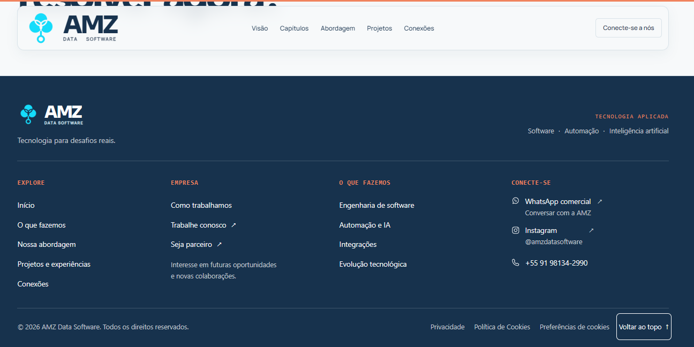
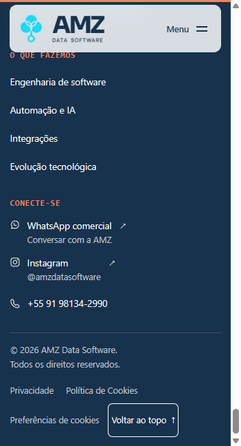
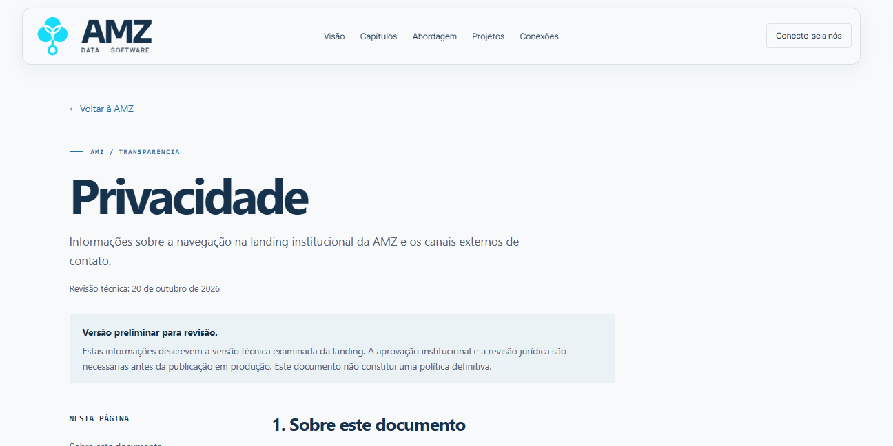
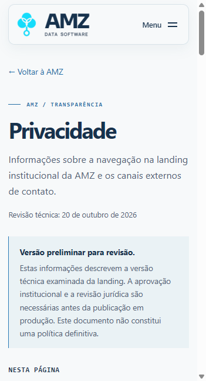
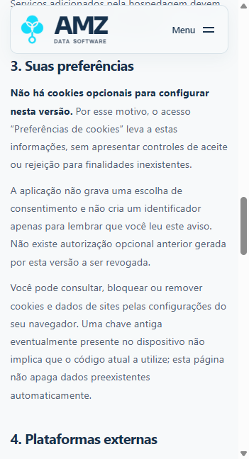

# AMZ — Refinamento do rodapé, privacidade e cookies

Data: 20/10/2026. Projeto: `D:\dev\repositorios\landing-page\amz-landing-starter`, branch `main`.

## A. Refinamento do rodapé

Mantidos os três níveis: identidade, quatro colunas e faixa inferior. Ajustadas as proporções das colunas, títulos de 13 px, links de 15 px e textos secundários de 14 px no desktop, com áreas de toque confortáveis no mobile. Paleta e marca preservadas. O retorno ao topo tem borda zero e fundo transparente; o contorno branco aparece somente como foco acessível de teclado. Talentos e parcerias mantêm setas discretas e os destinos centralizados existentes.

A faixa inferior separa navegação institucional e documentos: `/privacidade`, `/cookies`, `/cookies#preferencias` e retorno ao início. O link de preferências é informativo, não um painel de opções fictícias. O contato comercial continua minimalista, com a única ação principal para WhatsApp. Nenhuma outra seção, texto, print ou script de motion foi alterado nesta etapa.

## B. Auditoria técnica de cookies e armazenamento

Método: busca no código-fonte e JavaScript de produção; observação das requisições e cabeçalhos de resposta no navegador; leitura de cookies, nomes de chaves de armazenamento, service workers, Cache Storage e IndexedDB. Nenhum valor de armazenamento preexistente foi exportado. Não houve limpeza de dados do navegador.

Ambientes: desenvolvimento em `http://localhost:4321/` e build estático em `http://localhost:4323/`. A origem de armazenamento do build era nova na observação inicial; cookies foram conferidos separadamente, pois não são isolados por porta. O cache de rede da aba de teste foi desabilitado temporariamente para inspecionar carregamentos. Não houve visita a ambientes autenticados dos produtos AMZ.

| Recurso observado | Fornecedor/origem | Finalidade / categoria técnica | Duração | Necessidade e consentimento |
|---|---|---|---|---|
| Cookies próprios e de terceiros | Nenhum encontrado na visita observada | Inventário vazio | Não aplicável | Não há cookies opcionais ativos identificados |
| `localStorage` e `sessionStorage` criados pela aplicação | Nenhum encontrado no build estático | Inventário vazio | Não aplicável | Não foi criada escolha de consentimento sem finalidade |
| `amz-trevo-reference-trace-v1` no localStorage da origem de desenvolvimento | Autoria e criação não confirmadas; sem referência no código atual | Dado residual encontrado no navegador, não classificado como recurso ativo desta versão | Persistente; data de criação desconhecida | Não necessário ao código atual; preservado. Não aparece na origem nova do build |
| Estado do menu, accordion, motion e pausa do marquee | Aplicação AMZ, mesma origem | Interface; estado em memória, sem identificador persistente | Vida da página | Funcionalidade local; não é cookie nem rastreador |
| HTML, CSS, JS, fontes e imagens | Mesma origem da aplicação | Entrega da página; cache HTTP não equivale a cookie | No preview examinado, `Cache-Control: no-cache` requer revalidação; produção depende da hospedagem | Não foram usados como identificadores de publicidade ou análise |
| Vite e toolbar Astro | Ambiente local de desenvolvimento | Atualização e inspeção durante desenvolvimento | Execução local | Não integram o build estático; não foram tratados como fornecedores de analytics da landing |
| Links para WhatsApp e Instagram | Plataformas externas | Abrir canais após ação do visitante | Depende da plataforma visitada | Não há widget, pixel ou conversa incorporada à landing |
| Logs, CDN e proteção de borda em produção | Não verificados | Depende da infraestrutura definitiva | Não confirmada | Revisão obrigatória antes da publicação; não atribuída base legal nesta auditoria |

No build estático, antes e depois da implementação: cookies vazios; localStorage e sessionStorage vazios; nenhuma requisição externa no carregamento inicial observado; nenhum cabeçalho Set-Cookie nas respostas observadas. A leitura adicional encontrou zero service workers, Cache Storage e bases IndexedDB na origem auditada. O código não contém formulários, tag manager, pixels ou analytics. Imagens lazy são locais; não foram confundidas com conteúdo externo.

Limite: a inspeção local não comprova o comportamento de uma hospedagem de produção não fornecida. Também não constitui atestado geral de conformidade com a LGPD.

Evidências: [rede antes](2026-10-20-rodape-privacidade-cookies-assets/rede-antes.json), [rede depois](2026-10-20-rodape-privacidade-cookies-assets/rede-depois.json), [viewports](2026-10-20-rodape-privacidade-cookies-assets/responsividade.json). A matriz final registra os cinco tamanhos exatos solicitados, incluindo 768 × 1024.

## C. Gerenciamento de consentimento

**Modo implementado: informativo.** Não há recurso opcional real que justifique banner, modal de categorias, botões de aceite/rejeição ou gravação de consentimento. Não foi adicionado JavaScript, biblioteca ou cookie para gerenciar finalidades inexistentes.

O módulo reutilizável `src/lib/privacy.ts` centraliza versão, data de auditoria, rotas, inventário e estado. O layout executa sua verificação durante a geração: cadastrar um recurso opcional sem revisar a implementação lança erro e impede o build. A verificação do guard foi executada com uma alteração exclusivamente em memória, sem inserir fornecedores no código publicado.

Isso é uma estrutura de preparação, não uma CMP pronta para futuros rastreadores. Uma ativação futura exigirá nova implementação e testes de bloqueio antes do consentimento, categorias reais, persistência versionada com data, rejeição equivalente, recarga, revisão, revogação, interrupção de eventos e tratamento de identificadores. O guard não intercepta scripts que alguém adicione por fora do inventário: revisão de código e auditoria de rede continuam necessárias.

Não há consentimento anterior gerado por esta versão para retirar, nem identificadores ativos para apagar. A página explica o controle de dados pelas configurações do navegador, sem apagar chaves residuais automaticamente.

## D. Privacidade e páginas institucionais

Implementadas `/privacidade` e `/cookies` com layout de leitura compartilhado, header e footer existentes, índice de seções, aviso explícito de versão preliminar, data de revisão técnica e metatag `noindex, nofollow`. Não houve deploy. `noindex` não é bloqueio de acesso nem substituto da aprovação de publicação.

O conteúdo distingue a navegação da landing das mensagens recebidas no WhatsApp/Instagram. Não atribui à landing armazenamento de mensagens, coleta por formulário, certificação, CNPJ, encarregado, prazo de retenção ou base legal não confirmados.

### Informações necessárias antes da política definitiva

| Tema | Situação / aprovação necessária |
|---|---|
| Responsável pelo site e controlador | Marca AMZ conhecida; razão social, CNPJ e identificação jurídica do controlador devem ser fornecidos e validados |
| Dados coletados | Frontend auditado sem formulário ou rastreador; confirmar dados efetivamente recebidos e tratados no atendimento |
| Contatos comerciais e oportunidades | Links e mensagens pré-preenchidas verificados; confirmar responsáveis, fluxos internos e finalidades de cada atendimento |
| Bases legais | Mapear e validar por atividade; não presumir consentimento para tudo |
| Cookies e tecnologias | Inventário local realizado; repetir na infraestrutura de produção |
| Terceiros e compartilhamento | Canais externos identificados; confirmar hospedagem, operadores, destinatários e possíveis transferências |
| Armazenamento e retenção | Não inventados; definir critérios e prazos conforme as atividades reais |
| Segurança | Recursos estáticos locais e ausência de banco de visitantes no frontend verificados; confirmar controles efetivos do atendimento e da infraestrutura |
| Direitos dos titulares | Texto geral referenciado à ANPD; aprovar procedimento de recebimento, identificação e atendimento |
| Canal de privacidade | WhatsApp comercial disponível como contato geral; validar responsável e eventual canal específico. Não apresentado como contato de DPO |
| Atualização | Data é da auditoria técnica; aprovação, vigência e governança da versão final pendentes |

**Termos de Uso:** nenhum texto aprovado foi fornecido. Não foi criada página vazia nem contrato de SaaS para uma landing. Recomenda-se avaliar juridicamente eventual aviso sobre uso do conteúdo e links externos, se pertinente ao site; condições de assinatura e uso dos softwares pertencem a seus próprios contextos.

## E. Capturas visuais

Capturas do build estático, sem toolbar de desenvolvimento. Para evitar artefatos da superfície de captura do navegador em alturas maiores, os prints foram enquadrados em viewports compactos; a validação de layout nos cinco tamanhos solicitados foi feita separadamente. O mobile aparece em duas posições da página, sem esconder conteúdo por accordion.

### Rodapé desktop

### Rodapé mobile — identidade e navegação

### Rodapé mobile — contatos e documentos

### Privacidade

### Preferências informativas

Banner e painel modal: não aplicáveis; não foram fabricados para as capturas.

## F. Validações

- `npm run check`: 24 arquivos, zero erros, warnings ou hints.
- `npm run build`: quatro rotas estáticas geradas, sem dependências novas. Bundle cliente da home preservado: 78,47 kB, gzip 28,59 kB.
- `git diff --check`: sem erros de whitespace; Git emite avisos habituais de conversão LF/CRLF no checkout Windows.
- Home, Privacidade e Cookies: 1440 × 900, 1280 × 800, 768 × 1024, 390 × 844 e 360 × 800, sem overflow horizontal do documento ou do footer.
- Âncoras internas do footer: destinos existentes. Links de documentos e preferências: navegação funcional.
- Preferências: abre `/cookies#preferencias`, conteúdo informativo visível abaixo do header; recarga mantém a ausência de armazenamento criado pela aplicação.
- Retorno ao topo: `#inicio`, scrollY 0 com movimento reduzido; link sem borda permanente.
- Teclado: Shift+Tab entre retorno ao topo e preferências; foco visível branco. Navegação nativa sem modal nem foco preso.
- Âncora de contato desktop: título em aproximadamente 273 px, header terminando em 104 px; não sobreposto na verificação. WhatsApp preservado como ação principal.
- Console do build auditado: sem erros ou avisos observados.
- Contraste das cores do footer sobre Navy: branco 13,13:1; coral 5,07:1. Nas páginas novas, os links usam uma mistura localizada de 85% Blue e 15% Navy com contraste de aproximadamente 5,18:1 no Canvas; o token global não foi alterado. Textos secundários superam 5,5:1 nas superfícies claras usadas.
- Consentimento: primeira visita e recarga auditadas. Aceitar, rejeitar, salvar categorias e revogar: não aplicáveis ao inventário vazio; nenhum desses fluxos é declarado testado com rastreadores reais.
- Guard de configuração: modo sem banner e inventário vazio aprovados; cadastro experimental em memória lança erro, conforme esperado.

## G. Estado e pendências

**Implementado e testado:** refinamento do footer, links institucionais, páginas preliminares, índice, foco, movimento reduzido, rotas, modo informativo sem banner e inventário técnico local.

**Preparado:** configuração central versionada e barreira de build para futuras ativações. Não representa um gerenciador completo de futuros fornecedores.

**Depende da AMZ:** identidade jurídica, responsáveis, canal de privacidade, práticas reais de atendimento, retenção, compartilhamento, infraestrutura e aprovação das redações. Canais específicos de talentos e parcerias continuam pendentes.

**Depende de revisão jurídica:** bases legais por finalidade, atendimento de direitos, transferências quando existentes, redação definitiva, necessidade e conteúdo de Termos de Uso. Não publicar as versões preliminares como políticas definitivas.

**Sem commit, push ou deploy.** Alterações anteriores do checkout foram preservadas.

## Referências consultadas e aplicação

- [Linear](https://linear.app/) e [Privacy](https://linear.app/privacy): documento separado, data e hierarquia de leitura.
- [Stripe](https://stripe.com/br), [configurações](https://stripe.com/br/cookie-settings) e [política](https://stripe.com/br/legal/cookies-policy): separação entre documento e controles, inventário por finalidade e duração; não reproduzido seu volume de fornecedores.
- [Vercel](https://vercel.com/), [cookies](https://vercel.com/legal/cookie-policy) e [privacidade](https://vercel.com/legal/privacy-notice): navegação legal separada e delimitação de escopo.
- [CI&T](https://ciandt.com/br/pt-br/) e [aviso](https://ciandt.com/br/pt-br/aviso-de-privacidade): organização de informações de tratamento e canais; suas práticas não foram atribuídas à AMZ.
- [Guia ANPD sobre cookies](https://www.gov.br/anpd/pt-br/centrais-de-conteudo/materiais-educativos-e-publicacoes/guia_orientativo_cookies_e_protecao_de_dados_pessoais): inventário, finalidades claras, escolhas efetivas quando houver consentimento, opcionais desativados inicialmente e facilidade de revogação. Não implica que a AMZ deva criar categorias ou um banner sem tecnologias reais.
- [ANPD — perguntas frequentes](https://www.gov.br/anpd/pt-br/acesso-a-informacao/perguntas-frequentes/perguntas-frequentes): referência para redação geral sobre direitos; sem definir bases legais específicas da AMZ.
