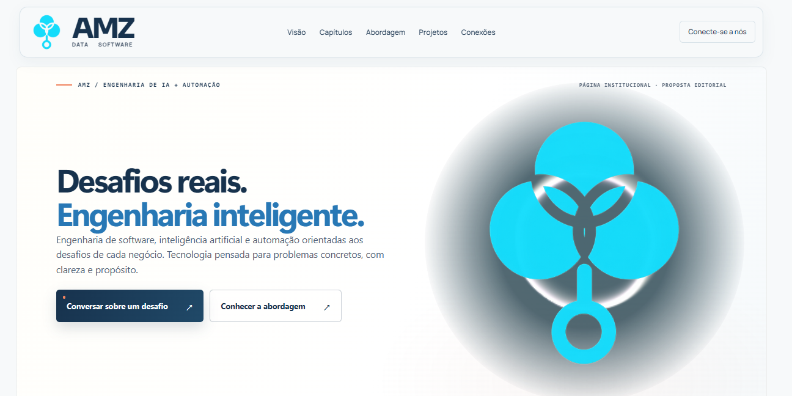
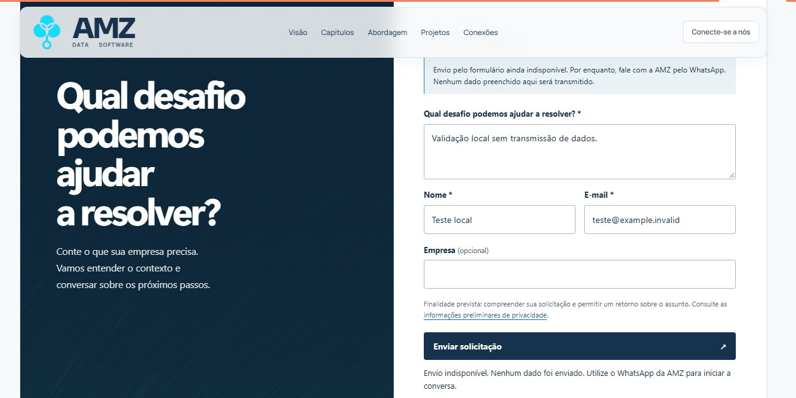
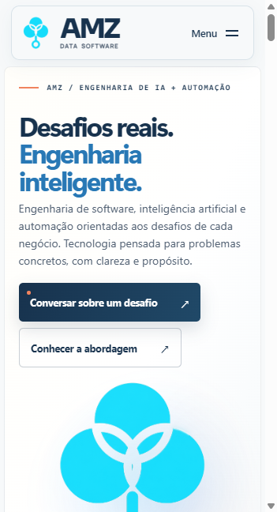
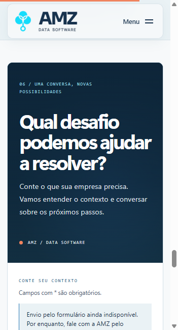
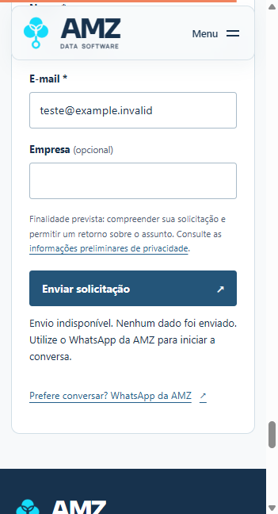

# Vanta e formulários institucionais — AMZ

## Direção e escopo

Implementação de 20/10/2026, no checkout `amz-landing-starter`, branch `main`. Sem commit, push ou deploy. A árvore já continha alterações locais, preservadas. As propostas editoriais da auditoria anterior não foram aplicadas.

Direção travada no design system existente e no briefing: Canvas #F7F9FA no Hero, marca oficial preservada, arte HALO restrita à região gráfica; encerramento em duas superfícies, navy com TOPOLOGY e formulário branco. Os efeitos são decorativos e não cobrem campos ou CTAs.

| Decisão | Referência e aplicação |
|---|---|
| Contato com mensagem e formulário lado a lado | [Globant Contact](https://www.globant.com/contact): convite e desafio como início da conversa; composição autoral navy/branco AMZ, menos campos |
| Preservar abertura e clareza das ações | [Linear](https://linear.app/): hierarquia de propósito e ações; sem importar layout ou catálogo |
| Cor concentrada na arte | [Stripe](https://stripe.com/): separar expressão gráfica de conteúdo funcional; nenhuma paleta da referência copiada |
| Bordas discretas e campos explícitos | [Vercel](https://vercel.com/): precisão e contraste, aplicados aos tokens existentes |
| Efeitos reais | [Vanta](https://www.vantajs.com/): HALO e TOPOLOGY, sem substituição por simulação CSS |

A consulta ao Refero retornou `NO_SUBSCRIPTION`. Foram usadas as referências primárias acima e o briefing como base. Não houve cópia de ativos externos.

## Dependências e compatibilidade

Instaladas e fixadas: `vanta@0.5.24`, `three@0.134.0`, `p5@1.1.9`. Motion `14.3.0` e Astro `5.18.2` preservados. Não existia Three instalado antes desta etapa: não houve downgrade global nem segunda versão de Three. O laboratório Trevo e o antigo script atmosférico já estavam removidos do código ativo; o componente Atmosphere remanescente é CSS estático e foi preservado.

- [README oficial](https://github.com/tengbao/vanta/blob/master/README.md) usa Three r134.
- [HALO oficial](https://github.com/tengbao/vanta/blob/master/src/vanta.halo.js) utiliza `RGBFormat` e os parâmetros `baseColor`, `color2`, `backgroundColor`, `speed`, `amplitudeFactor` e `size`.
- [TOPOLOGY oficial](https://github.com/tengbao/vanta/blob/master/src/vanta.topology.js) utiliza p5, `color` e `backgroundColor`. p5 1.1.9 é a versão indicada pela galeria oficial consultada.
- O adaptador `src/lib/vantaTopology.ts` usa o código-fonte ESM publicado do efeito. Sobrescreve apenas `initThree` da base específica p5, cuja implementação herdada tentava encontrar Three e emitia aviso irrelevante. HALO mantém sua própria base do bundle oficial. Não há alteração em node_modules, cópia do efeito ou supressão global de console.
- Ao destruir HALO, o integrador também libera seus dois render targets e o renderer/contexto, recursos que o descarte upstream não libera integralmente.

## Ciclo de vida e carregamento

Motores e efeitos são importados dinamicamente apenas com a superfície visível. IntersectionObserver destrói as instâncias ao sair da tela; callbacks assíncronos obsoletos são invalidados. Mudança de preferência de movimento, viewport, visibilidade da página e pagehide interrompem os loops. pageshow permite restauração de BFCache com a mesma paleta.

Cinco famílias cromáticas são sorteadas uma vez por documento e compartilhadas pelos dois efeitos, sem cookies, localStorage ou sessionStorage. Não mudam ao rolar. Em telas abaixo de 768px, movimento reduzido e conexões com saveData, os motores não são carregados: a composição estática preserva a marca e o contraste. TOPOLOGY é limitado a 30 FPS. Não houve biblioteca de interface adicional.

## Estado dos formulários

| Jornada | Rota | Situação real |
|---|---|---|
| Comercial | `/#contato` | Validação local; envio não configurado; WhatsApp confirmado |
| Interesse profissional | `/carreiras` | Sem vagas inventadas, cadastro de talentos ainda inativo, sem upload de currículo; WhatsApp |
| Propostas de colaboração | `/parcerias` | Apresentação de possibilidades sujeitas a análise; envio não configurado; WhatsApp |

Não foram encontrados endpoint, provedor de formulário, destino de e-mail, adaptador server-side ou configuração de hospedagem de envio. `src/config/forms.ts` mantém os três endpoints em `null`. Os dados preenchidos não são transmitidos nem armazenados pela aplicação. O link WhatsApp não inclui os campos preenchidos.

Para ativar cada jornada, faltam: (1) escolher e aprovar serviço HTTPS e destinatário; (2) configurar credenciais exclusivamente no serviço/server; (3) validar finalidade, acesso e retenção com a AMZ e atualizar a política preliminar; (4) implementar no endpoint validação independente, limites de tamanho, rate limit e proteção antispam; (5) configurar CORS para a origem aprovada; (6) preencher o endpoint público no config e revalidar sucesso/falha reais.

Contrato preparado: `POST application/json` com `kind`, `message`, `name`, `email`, `company` quando aplicável, e honeypot `website`. Retorno 2xx JSON `{ "accepted": true, "receipt": "identificador-nao-vazio" }` somente após recebimento real. Timeout de 15s, credenciais omitidas, sem anexos. Honeypot é apenas apoio, não substitui proteção no servidor. Nenhum serviço foi simulado como funcional.

Campos obrigatórios têm label, mensagens vinculadas por aria-describedby, aria-invalid e foco no primeiro erro. Há aviso inicial de indisponibilidade, feedback verdadeiro ao tentar enviar e alternativa WhatsApp. Sem JavaScript o botão permanece desabilitado e a alternativa continua disponível. As políticas continuam preliminares; foram atualizadas apenas descrições técnicas.

## Arquivos desta etapa

- `astro.config.mjs`, `package.json`, `package-lock.json`.
- `src/components/graphics/VisualEffect.astro`.
- `src/components/sections/Hero.astro`, `Contact.astro`.
- `src/components/ui/InstitutionalForm.astro`.
- `src/components/layout/SiteFooter.astro` (somente destinos de oportunidades).
- `src/config/site.ts`, `forms.ts`, `visualPalettes.ts`.
- `src/scripts/visualEffects.ts`, `institutionalForms.ts`, `src/types/vanta.d.ts`.
- `src/lib/vantaTopology.ts`, `src/lib/privacy.ts` (versão do inventário), `src/layouts/OpportunityLayout.astro`.
- `src/pages/carreiras.astro`, `parcerias.astro`, `privacidade.astro`, `cookies.astro`.
- Este relatório e evidências.

`Overview.astro`, `Chapters.astro`, `pageMotion.ts`, demais seções, imagens, tokens e navegação principal não foram editados nesta etapa.

## Limitação preexistente de dependências

O npm audit consultado após a instalação sinalizou três pacotes: Astro (crítico), sharp (alto) e esbuild (baixo), todos pertencentes à árvore existente. Não atribuiu alertas às três novas bibliotecas. O remédio automático sugerido é migração major de Astro, fora deste escopo; não foi executado `audit fix --force`. Isso precisa de uma atualização dedicada antes de publicar. A validação local estática não equivale à análise de exposição de um ambiente de produção.

## Validação e evidências

Inspeção realizada na versão estática, além das verificações de código e build abaixo.

### Resultados de build e impacto

- `npm run check`: 35 arquivos, 0 erros, 0 warnings e 0 hints.
- `npm run build`: seis rotas estáticas geradas. Aviso de tamanho >500 kB para os motores; não ocultado.
- `git diff --check`: exit 0; Git avisa apenas sobre normalização futura LF/CRLF na árvore Windows existente.

| Chunk | Minificado | Gzip de referência do build |
|---|---:|---:|
| Motion / home existente, sem alteração de hash | 79,79 kB | 29,09 kB |
| Integrador visual | 4,14 kB | 2,00 kB |
| HALO | 20,61 kB | 7,03 kB |
| Three r134 | 613,57 kB | 156,71 kB |
| TOPOLOGY + adaptador | 10,52 kB | 3,65 kB |
| p5 | 813,83 kB | 192,11 kB |

HALO acrescenta aproximadamente 164 kB gzip quando a arte entra em tela; TOPOLOGY cerca de 196 kB gzip ao chegar ao contato. São arquivos separados e locais. O formulário é um pequeno módulo incorporado pelo build. Os valores gzip são estimativas de compressão, não medição de transferência em uma hospedagem configurada. Não foi feita pontuação Lighthouse nem promessa de FPS em dispositivos físicos. Em mobile/reduced-motion os motores ficam ausentes das requisições iniciais, conferido no navegador.

### Navegador real

Prévia estática testada em `localhost:4323`. Em 1440×900, 1280×800, 768×1024, 390×844 e 360×800: sem overflow horizontal da página ou dos campos. Em tablet de 768px, TOPOLOGY foi confirmado ativo após posicionar o contato em tela. Em mobile, fallback estático intencional. Capturas usam janelas de 1440×720 e 390×720 para registrar a composição sem artefatos de captura da janela maior do navegador integrado; as cinco dimensões solicitadas foram verificadas separadamente no DOM.

Com preferência reduzida e reload, zero canvases e nenhuma requisição de Three, p5, HALO ou TOPOLOGY. Formulários e links continuam disponíveis. Teclado no contato: Tab após a mensagem leva ao nome; envio vazio foca o primeiro erro, e e-mail inválido tem mensagem específica.

Nos três formulários foram exercitados envio vazio e dados sintéticos válidos (`example.invalid`). Resultado: erros acessíveis ou mensagem de envio indisponível, sem sucesso fictício. Não houve envio externo. O formulário de carreiras não possui campo de arquivo.

Âncoras dos quatro serviços verificadas com teclado: hash, foco e card ativo correspondem a engenharia, integração, automação e modernização. Retorno do histórico de modernização para automação conferido. Nenhuma fórmula ou correção anterior do scroll foi modificada.

Reentrada repetida Hero → Contato → Hero → Contato: um único canvas na superfície visível e zero na outra; mesma paleta ao longo dos ciclos. Em reload, a seleção observada mudou de ciano/azul para violeta/ciano. O console da prévia estática e de uma carga final do dev server permaneceu sem erros ou avisos dos efeitos. O adaptador p5 aguarda o evento load antes da construção, garantindo que o descarte também seja seguro em carregamentos rápidos.

O módulo principal da home permaneceu `D-ul3Alz.js`, com os mesmos 79,79 kB: as correções anteriores de Motion e navegação foram preservadas. A mudança de privacidade foi apenas factual e o inventário recebeu versão `2026-10-20.2`.

### Prints reais

Abertura desktop — HALO ativo:

Contato desktop — TOPOLOGY ativo e feedback de envio indisponível:

Abertura mobile — fallback estático, sem baixar motores:

Contato mobile — mensagem antes do formulário:

Formulário mobile — feedback verdadeiro:

[Resultados de navegador em JSON](2026-10-20-vanta-contato-assets/qa-navegador.json) · [Versões instaladas](2026-10-20-vanta-contato-assets/dependencias.json).

## Pendências de publicação

- Serviço/destinatários e controles server-side dos três formulários; credenciais apenas no backend. Até lá o WhatsApp é a alternativa funcional.
- Aprovação institucional e jurídica das práticas de tratamento e das políticas preliminares.
- Atualização dedicada do conjunto Astro/Sharp/esbuild sinalizado pelo npm audit; não misturada a esta implementação visual.
- Auditoria do ambiente real de hospedagem e performance em dispositivos físicos. Os efeitos são intencionalmente estáticos em mobile; nenhum FPS universal é prometido.
