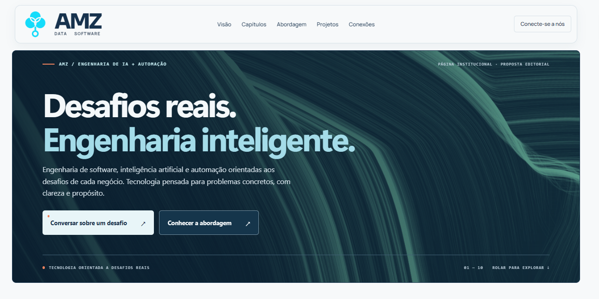
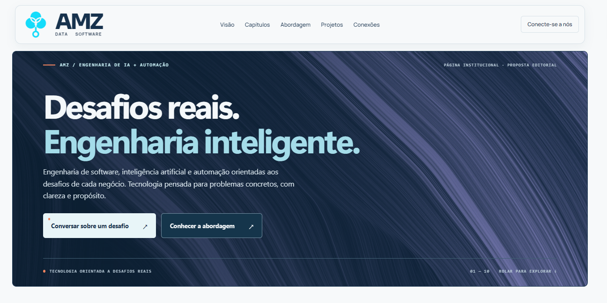
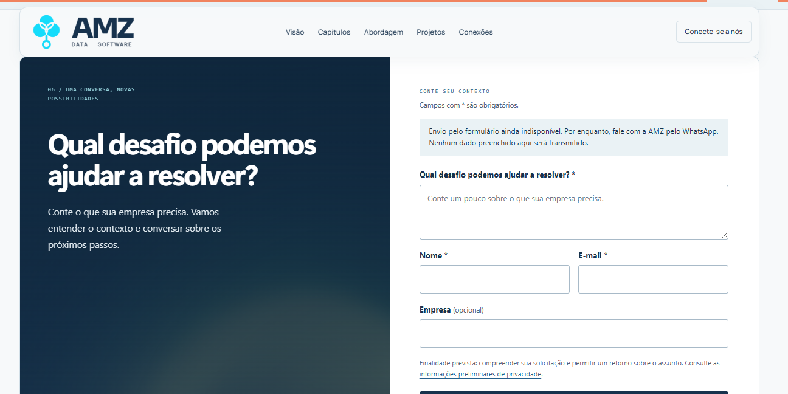
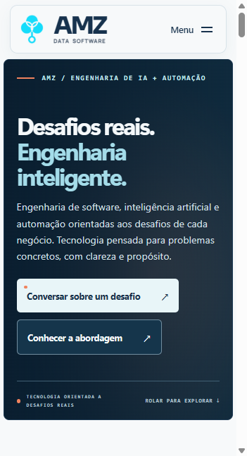
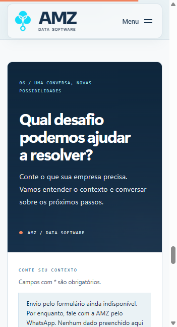
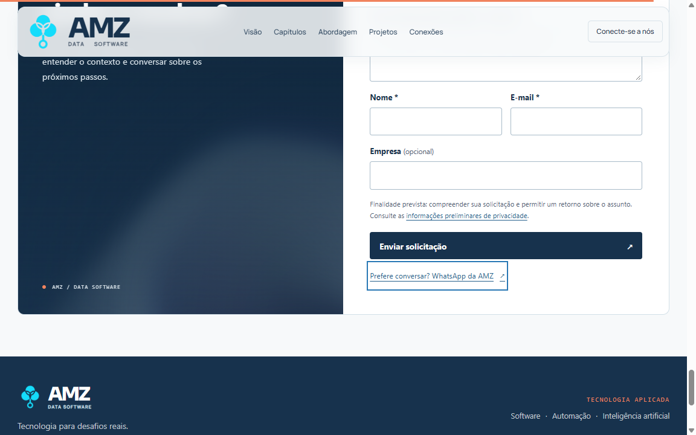

# AMZ — Refinamento visual Vanta

Data: 20/10/2026. Checkout `amz-landing-starter`, branch `main`. Esta etapa substitui a direção visual da integração anterior; não instala dependências nem altera as demais seções.

## Direção aplicada

- TOPOLOGY cobre toda a superfície do Hero, respeitando os arredondamentos. Header externo permanece no canvas claro. Uma sobreposição navy favorece a leitura; título branco/ciano, CTA principal claro e ação secundária navy com borda. Mensagem, apoio, destinos e rótulos dos CTAs preservados.
- Símbolo ampliado, contorno e iluminação circular removidos do Hero. A marca oficial continua no header.
- HALO restrito e recortado pelo painel esquerdo do contato, deslocado para baixo/direita, com baixa opacidade e borda difusa. Formulário branco preservado, sem efeito atrás dos campos.
- Título do contato com largura maior e escala menor: duas linhas no desktop observado. Ajuste próprio para mobile, sem perder hierarquia.
- Cinco famílias cromáticas sorteadas por documento. Linhas de TOPOLOGY têm acento mais presente; HALO utiliza base e acento menos saturados. Sem troca de paleta durante a visita.

A direção segue o briefing e o design system AMZ. Referências dos efeitos: [TOPOLOGY](https://www.vantajs.com/?effect=topology) e [HALO](https://www.vantajs.com/?effect=halo). Não houve novo layout de página, assets copiados ou novo sistema de animação.

## Parâmetros finais

| Efeito | Configuração |
|---|---|
| TOPOLOGY | `color` e `backgroundColor` sorteados; implementação original com 4.500 partículas; p5 configurado a 30 FPS e `pixelDensity(1)`; sem parâmetro `speed` |
| HALO | `speed: 0.16`, `amplitudeFactor: 0.4`, `size: 1.4`, `xOffset: 0.1`, `yOffset: -0.18`; `baseColor`, `color2` e `backgroundColor` da família sorteada; `scale: 2` |
| Composição do HALO | Opacidade 0,26; saturação CSS 0,55; difusão de 18 px; máscara elíptica assimétrica; canvas recortado pelo painel |

A velocidade HALO anterior era 0,45. O novo valor corresponde a aproximadamente 36% do anterior, aplicado ao tempo do efeito. Não é uma medição de FPS.

Inspeção do código da versão instalada: TOPOLOGY não oferece controle de velocidade. `ringFactor` e `rotationFactor` aparecem nos defaults do HALO, mas não participam do cálculo do fragment shader publicado, portanto foram omitidos. `color2` é aceito pelo efeito, mas seu uso no fragment shader está comentado: não foi tratado como controle efetivo de intensidade. A contenção visual vem de `baseColor`, composição, opacidade e saturação. Nenhum shader ou arquivo em node_modules foi modificado.

## Recursos e ciclo de vida

Preservados: imports dinâmicos, IntersectionObserver, invalidação de tarefas assíncronas obsoletas, destruição fora da viewport, descarte dos render targets/renderer HALO, redução de movimento, saveData e fallback em telas menores que 768 px. Paletas permanecem em memória.

TOPOLOGY utiliza p5 e HALO utiliza Three. O adaptador p5 existente limita a densidade antes de criar o canvas e delega o resize ao gerenciador: o `scale` de Vanta não controla a densidade p5. Em resize, ResizeObserver integrado ao mesmo gerenciador recria TOPOLOGY após 180 ms de estabilização, pois seu campo de fluxo captura as dimensões no setup. Sem aumentar partículas ou criar um segundo inicializador.

Versões mantidas: Vanta 0.5.24, Three 0.134.0, p5 1.1.9 e Motion 14.3.0. Nenhuma instalação, remoção ou alteração de lockfile nesta etapa.

## Escopo e preservação

Somente sete arquivos de código foram alterados, conferidos por hashes de toda a pasta src antes/depois:

1. `src/components/sections/Hero.astro`
2. `src/components/sections/Contact.astro`
3. `src/components/graphics/VisualEffect.astro`
4. `src/config/visualPalettes.ts`
5. `src/scripts/visualEffects.ts`
6. `src/lib/vantaTopology.ts`
7. `src/types/vanta.d.ts`

Accordion, cards, diagramas, abordagem, prints, cápsulas, footer, páginas de carreiras/parcerias, privacidade e sistema de formulário ficaram idênticos ao início desta etapa. O script principal da home manteve o hash `D-ul3Alz.js` e 79,79 kB / 29,09 kB gzip.

Os três endpoints continuam nulos. Aviso de indisponibilidade, validação e alternativa WhatsApp preservados; nenhum sucesso fictício ou envio externo foi ativado.

## Validações

Resultados e evidências finais abaixo.

- `npm run check`: 35 arquivos, zero erros/warnings/hints.
- `npm run build`: seis rotas geradas, sem erros. O aviso de chunks de motores maiores que 500 kB permanece visível.
- `git diff --check`: exit 0.

Bundles: integrador 4,92 kB / 2,27 kB gzip; adaptador TOPOLOGY 10,65 / 3,70; p5 813,83 / 192,11; HALO 20,61 / 7,03; Three 613,57 / 156,71. A troca coloca cerca de 196 kB gzip de motor/efeito na abertura desktop, antes cerca de 164 kB. São aproximadamente 32 kB a mais na abertura, por escolha explícita do efeito p5; o total dos motores não mudou. Three só é solicitado quando o contato se torna visível. Em mobile e movimento reduzido, ambos são dispensados. Gzip é a estimativa do build; depende da compressão da hospedagem.

Amostra de atividade da aba com HALO: 73,58 s de relógio, 8,51 s de TaskDuration e 1,63 s de ScriptDuration segundo Chrome Performance. Esses números abrangem toda a aba e não isolam o efeito, não medem GPU nem equivalem a FPS. Não há promessa de desempenho universal. Canvas TOPOLOGY observado com backing 1364×558 para área CSS aproximadamente 1364×558, inclusive em DPR 1,8: a densidade ficou limitada a 1.

Contraste calculado de tokens sobre as cinco bases sorteadas: título claro, acento claro e apoio mantêm contraste alto. A conferência visual das linhas em movimento é complementar; o cálculo de cor-base não representa todos os pixels de todos os frames.

Amostra com TOPOLOGY ativo: 46,39 s de relógio, 8,48 s de TaskDuration e 4,60 s de ScriptDuration. Assim como a amostra HALO, inclui a aba inteira e não é benchmark comparativo isolado. p5 permanece a 30 FPS configurados; não foi medido FPS em dispositivo físico. A mudança de motor na abertura tem custo real de download e processamento, mitigado por densidade 1, descarte fora de tela e fallback mobile/reduced-motion.

Bases das cinco paletas: contraste de 13,53:1 a 14,09:1 para o título claro; 9,63:1 a 10,03:1 para o acento tipográfico; 11,07:1 a 11,52:1 para o apoio. Textos e botões foram também inspecionados visualmente em duas paletas reais sorteadas.

### Conferência no navegador

Prévia estática local em `localhost:4323`, com inspeção adicional do dev server. Larguras 360, 390, 768, 1280 e 1440 px sem overflow horizontal ou campos escapando da página. No desktop o título do contato ocupa duas linhas; no mobile final, três. Hero mobile conserva o card navy, mensagem e duas ações, sem canvas.

Resize 1440 → 1280 → 768: TOPOLOGY recriado com backing compatível com a área CSS (1210×608 e 727×638 nos pontos observados), um único canvas. Ao sair da seção, zero canvases naquela superfície. As preferências reduzidas e a carga inicial mobile foram conferidas após reload: zero canvases e nenhuma requisição de p5/Three/efeitos. A condição saveData existente foi preservada no código, sem emulação de um dispositivo com economia de dados nesta bateria.

Formulário: envio vazio produz mensagens específicas e foco no primeiro campo; dados sintéticos válidos resultam em “Envio indisponível. Nenhum dado foi enviado”. O aviso inicial e WhatsApp continuam presentes. Nenhuma solicitação foi transmitida. As páginas secundárias e seu código não foram alterados.

Paletas capturadas: verde/azul e violeta/ciano, sorteadas naturalmente em dois carregamentos. As diferenças de traçado são também parte da inicialização original do TOPOLOGY; não são apenas troca de um filtro.

### Capturas reais

Hero completo — paleta verde/azul:

Segunda paleta — violeta/ciano:

Contato — HALO difuso abaixo da mensagem:

Mobile — abertura e contato com fallback estático:

As capturas usam quadros de 1440×720 e 390×720 para evitar um artefato do navegador integrado ao capturar janelas mais altas; as cinco larguras e dimensões de referência foram conferidas separadamente. A captura inicial do contato enquadra mensagem e campos; o complemento abaixo registra a parte inferior.

## Limitações e entrega

- Motores ainda geram aviso de tamanho no build. O custo de p5 na primeira impressão foi explicitado, não escondido.
- Arte TOPOLOGY acumula suas linhas ao longo da execução original. O preenchimento inicial é gradual, sem acelerar o algoritmo ou simular um parâmetro speed.
- Validações de navegador e Chrome Performance não substituem avaliação em hardware físico de entrada nem medem desempenho de uma hospedagem definitiva.
- Serviço de envio permanece não configurado, conforme solicitado. Nenhum backend foi ativado.
- Sem commit, push ou deploy.

### Correção encontrada na validação de resize

O resize rápido expôs uma falha upstream: `resizeCanvas` disparava `draw` usando a malha antiga de TOPOLOGY, produzindo acesso a uma célula inexistente. A correção fica apenas no adaptador de integração: o resize automático da base p5 foi desativado para este efeito; o ResizeObserver existente no gerenciador destrói e recria o sketch após estabilização. Isso evita o redesenho intermediário inconsistente, sem alterar o algoritmo, shaders ou node_modules. A bateria final foi repetida em uma carga nova para separar o erro anterior dos resultados da correção.

Resultado após a correção: carga nova, sequência rápida 1440 → 1280 → 768 → 390 → 360 → 1440 → 768 → 1440, canvas recriado em 1364×638 para área CSS 1364×638 e console sem erros/warnings. Hero → Contato → Hero confirmou as contagens [1,0] → [0,1] → [1,0]. Âncora de integração manteve hash, foco e card ativo corretos. O erro anterior permanece descrito para transparência, separado dos resultados finais.

[Dados de navegador](2026-10-20-vanta-refinamento-assets/qa-navegador.json) · [Lista dos sete arquivos modificados](2026-10-20-vanta-refinamento-assets/arquivos-modificados.json).
